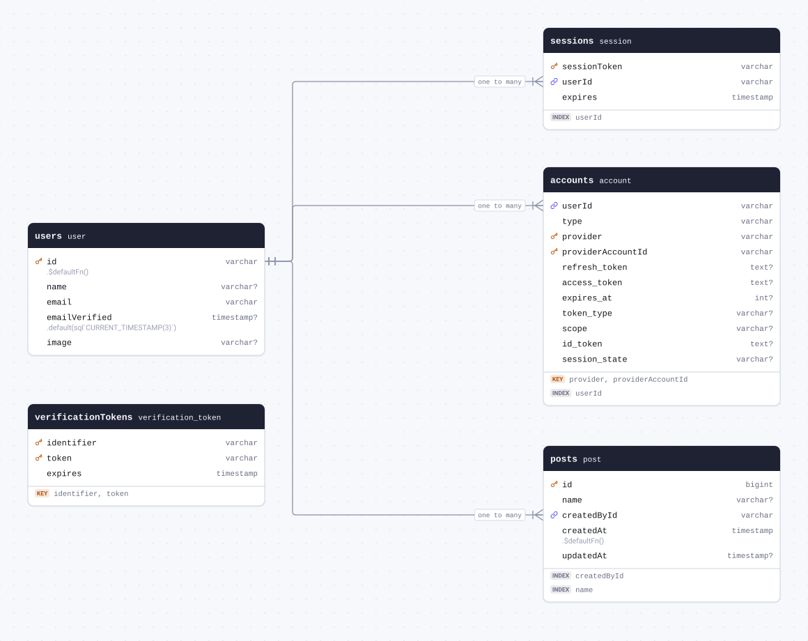
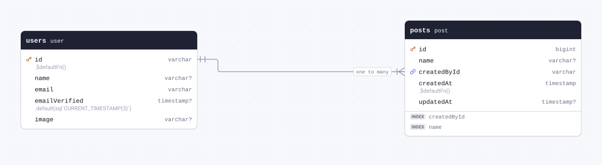
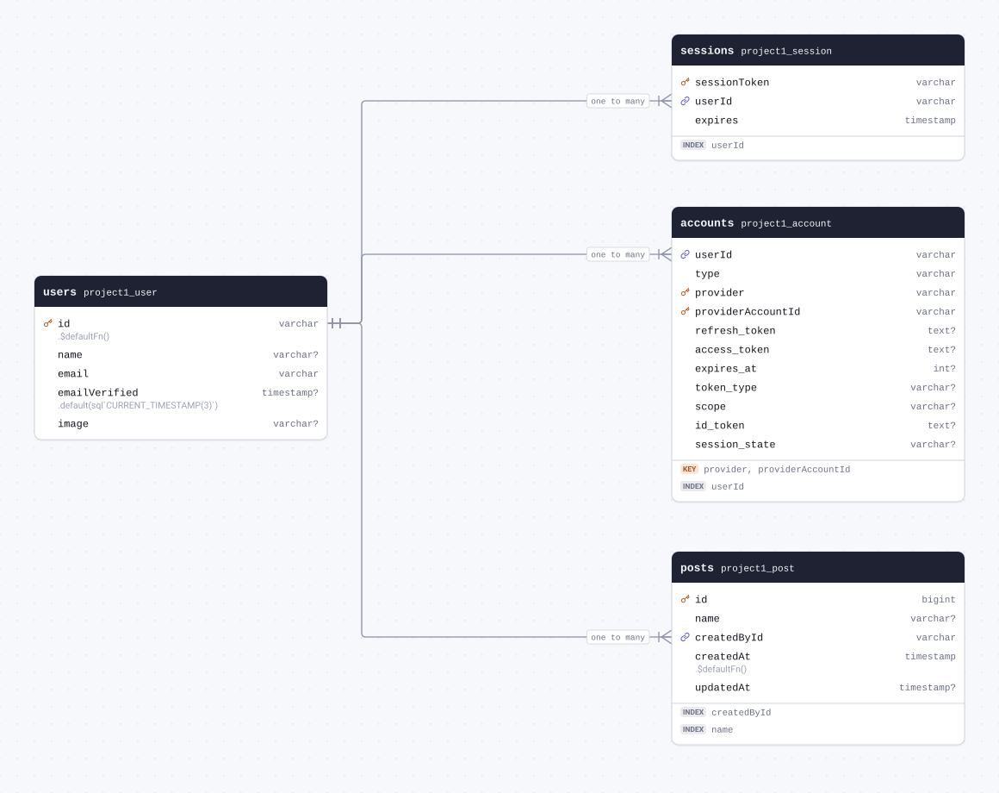
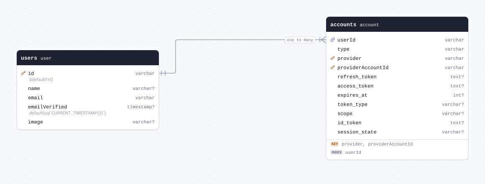
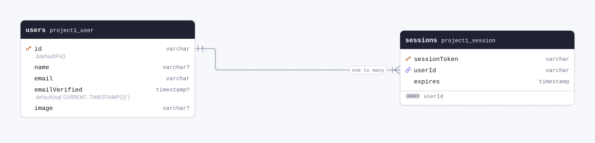

# Schema docs



## Contents

| Table                                           | Name in the database | Description |
| ----------------------------------------------- | -------------------- | ----------- |
| [posts](#table-posts)                           | `post`               |             |
| [users](#table-users)                           | `user`               |             |
| [accounts](#table-accounts)                     | `account`            |             |
| [sessions](#table-sessions)                     | `session`            |             |
| [verificationTokens](#table-verificationTokens) | `verification_token` |             |

## Tables

<a id="table-posts"></a>

### posts

Table `post`.



| Column        | Type        | Constraints                         | Default         | Description |
| ------------- | ----------- | ----------------------------------- | --------------- | ----------- |
| `id`          | `bigint`    | PK NOT NULL                         |                 |             |
| `name`        | `varchar`   | NULL                                |                 |             |
| `createdById` | `varchar`   | NOT NULL → [users.id](#table-users) |                 |             |
| `createdAt`   | `timestamp` | NOT NULL                            | `.$defaultFn()` |             |
| `updatedAt`   | `timestamp` | NULL                                |                 |             |

#### Indexes

- INDEX `createdById`
- INDEX `name`

#### References

- `createdById` → [users.id](#table-users) (many to one)

<details>
<summary>Queries</summary>

**Select**: Every row of posts.

```ts
db.select().from(posts);
```

**Count**: How many rows posts has.

```ts
db.$count(posts);
```

**Find many**: The rows of posts, through the relational query API.

```ts
db.query.posts.findMany();
```

</details>

<a id="table-users"></a>

### users

Table `user`.



| Column          | Type        | Constraints | Default                                 | Description |
| --------------- | ----------- | ----------- | --------------------------------------- | ----------- |
| `id`            | `varchar`   | PK NOT NULL | `.$defaultFn()`                         |             |
| `name`          | `varchar`   | NULL        |                                         |             |
| `email`         | `varchar`   | NOT NULL    |                                         |             |
| `emailVerified` | `timestamp` | NULL        | ``.default(sql`CURRENT_TIMESTAMP(3)`)`` |             |
| `image`         | `varchar`   | NULL        |                                         |             |

#### Referenced by

- `id` → [posts.createdById](#table-posts) (one to many)
- `id` → [accounts.userId](#table-accounts) (one to many)
- `id` → [sessions.userId](#table-sessions) (one to many)

<details>
<summary>Queries</summary>

**Select**: Every row of users.

```ts
db.select().from(users);
```

**Count**: How many rows users has.

```ts
db.$count(users);
```

**Find many**: The rows of users, through the relational query API.

```ts
db.query.users.findMany();
```

</details>

<a id="table-accounts"></a>

### accounts

Table `account`.



| Column              | Type      | Constraints                         | Default | Description |
| ------------------- | --------- | ----------------------------------- | ------- | ----------- |
| `userId`            | `varchar` | NOT NULL → [users.id](#table-users) |         |             |
| `type`              | `varchar` | NOT NULL                            |         |             |
| `provider`          | `varchar` | PK NOT NULL                         |         |             |
| `providerAccountId` | `varchar` | PK NOT NULL                         |         |             |
| `refresh_token`     | `text`    | NULL                                |         |             |
| `access_token`      | `text`    | NULL                                |         |             |
| `expires_at`        | `int`     | NULL                                |         |             |
| `token_type`        | `varchar` | NULL                                |         |             |
| `scope`             | `varchar` | NULL                                |         |             |
| `id_token`          | `text`    | NULL                                |         |             |
| `session_state`     | `varchar` | NULL                                |         |             |

#### Indexes

- PRIMARY KEY `provider`, `providerAccountId`
- INDEX `userId`

#### References

- `userId` → [users.id](#table-users) (many to one)

<details>
<summary>Queries</summary>

**Select**: Every row of accounts.

```ts
db.select().from(accounts);
```

**Count**: How many rows accounts has.

```ts
db.$count(accounts);
```

**Find many**: The rows of accounts, through the relational query API.

```ts
db.query.accounts.findMany();
```

</details>

<a id="table-sessions"></a>

### sessions

Table `session`.



| Column         | Type        | Constraints                         | Default | Description |
| -------------- | ----------- | ----------------------------------- | ------- | ----------- |
| `sessionToken` | `varchar`   | PK NOT NULL                         |         |             |
| `userId`       | `varchar`   | NOT NULL → [users.id](#table-users) |         |             |
| `expires`      | `timestamp` | NOT NULL                            |         |             |

#### Indexes

- INDEX `userId`

#### References

- `userId` → [users.id](#table-users) (many to one)

<details>
<summary>Queries</summary>

**Select**: Every row of sessions.

```ts
db.select().from(sessions);
```

**Count**: How many rows sessions has.

```ts
db.$count(sessions);
```

**Find many**: The rows of sessions, through the relational query API.

```ts
db.query.sessions.findMany();
```

</details>

<a id="table-verificationTokens"></a>

### verificationTokens

Table `verification_token`.

| Column       | Type        | Constraints | Default | Description |
| ------------ | ----------- | ----------- | ------- | ----------- |
| `identifier` | `varchar`   | PK NOT NULL |         |             |
| `token`      | `varchar`   | PK NOT NULL |         |             |
| `expires`    | `timestamp` | NOT NULL    |         |             |

#### Indexes

- PRIMARY KEY `identifier`, `token`

<details>
<summary>Queries</summary>

**Select**: Every row of verificationTokens.

```ts
db.select().from(verificationTokens);
```

**Count**: How many rows verificationTokens has.

```ts
db.$count(verificationTokens);
```

**Find many**: The rows of verificationTokens, through the relational query API.

```ts
db.query.verificationTokens.findMany();
```

</details>
