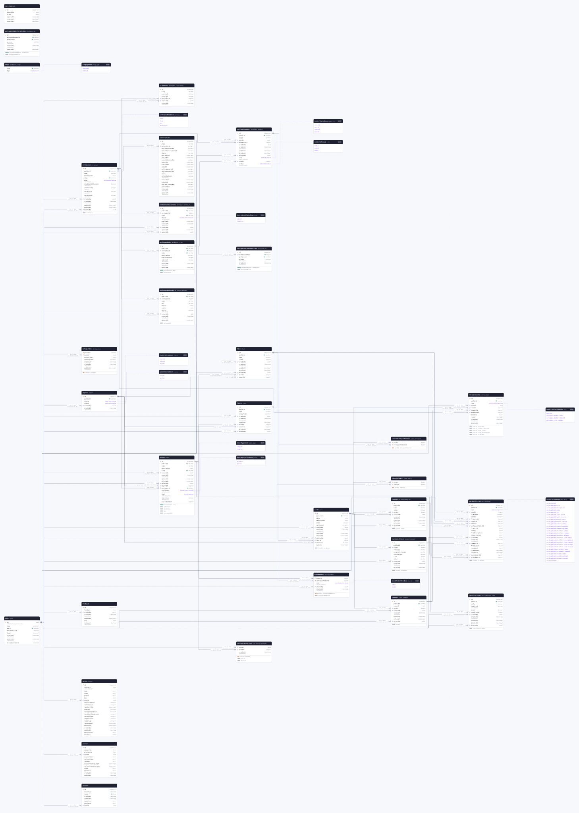
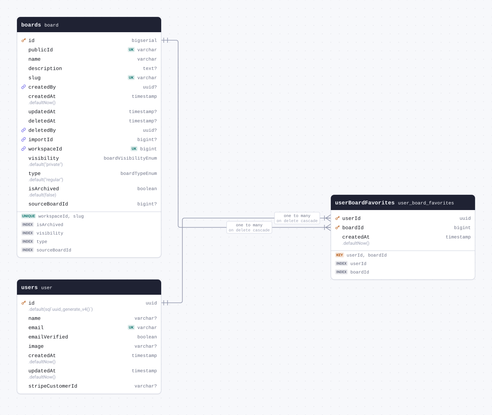
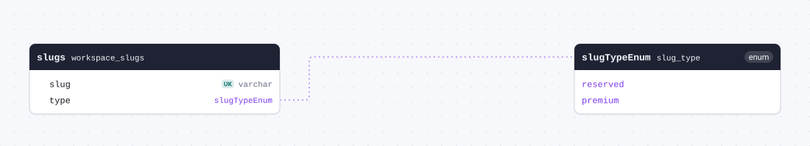

# Schema docs



<details>
<summary>The whole schema as SQL</summary>

```sql
CREATE TYPE "board_member_role" AS ENUM('admin', 'member');

CREATE TYPE "board_type" AS ENUM('regular', 'template');

CREATE TYPE "board_visibility" AS ENUM('private', 'public');

CREATE TYPE "card_activity_type" AS ENUM('card.created', 'card.updated.title', 'card.updated.description', 'card.updated.index', 'card.updated.list', 'card.updated.label.added', 'card.updated.label.removed', 'card.updated.member.added', 'card.updated.member.removed', 'card.updated.comment.added', 'card.updated.comment.updated', 'card.updated.comment.deleted', 'card.updated.checklist.added', 'card.updated.checklist.renamed', 'card.updated.checklist.deleted', 'card.updated.checklist.item.added', 'card.updated.checklist.item.updated', 'card.updated.checklist.item.completed', 'card.updated.checklist.item.uncompleted', 'card.updated.checklist.item.deleted', 'card.updated.attachment.added', 'card.updated.attachment.removed', 'card.updated.dueDate.added', 'card.updated.dueDate.updated', 'card.updated.dueDate.removed', 'card.archived');

CREATE TYPE "source" AS ENUM('trello', 'github');

CREATE TYPE "status" AS ENUM('started', 'success', 'failed');

CREATE TYPE "invite_link_status" AS ENUM('active', 'inactive');

CREATE TYPE "role" AS ENUM('admin', 'member', 'guest');

CREATE TYPE "member_status" AS ENUM('invited', 'active', 'removed', 'paused');

CREATE TYPE "notification_type" AS ENUM('mention', 'workspace.member.added', 'workspace.member.removed', 'workspace.role.changed');

CREATE TYPE "slug_type" AS ENUM('reserved', 'premium');

CREATE TYPE "workspace_plan" AS ENUM('free', 'team', 'pro', 'enterprise');

CREATE TABLE "account" (
	"id" bigserial PRIMARY KEY,
	"accountId" text NOT NULL,
	"providerId" text NOT NULL,
	"userId" uuid NOT NULL,
	"accessToken" text,
	"refreshToken" text,
	"idToken" text,
	"accessTokenExpiresAt" timestamp,
	"refreshTokenExpiresAt" timestamp,
	"scope" text,
	"password" text,
	"createdAt" timestamp NOT NULL,
	"updatedAt" timestamp NOT NULL
);

ALTER TABLE "account" ENABLE ROW LEVEL SECURITY;

CREATE TABLE "apiKey" (
	"id" bigserial PRIMARY KEY,
	"configId" text DEFAULT 'default' NOT NULL,
	"name" text,
	"start" text,
	"prefix" text,
	"key" text NOT NULL,
	"userId" uuid NOT NULL,
	"refillInterval" integer,
	"refillAmount" integer,
	"lastRefillAt" timestamp,
	"enabled" boolean,
	"rateLimitEnabled" boolean,
	"rateLimitTimeWindow" integer,
	"rateLimitMax" integer,
	"requestCount" integer,
	"remaining" integer,
	"lastRequest" timestamp,
	"expiresAt" timestamp,
	"createdAt" timestamp NOT NULL,
	"updatedAt" timestamp NOT NULL,
	"permissions" text,
	"metadata" text
);

ALTER TABLE "apiKey" ENABLE ROW LEVEL SECURITY;

CREATE TABLE "session" (
	"id" bigserial PRIMARY KEY,
	"expiresAt" timestamp NOT NULL,
	"token" text NOT NULL UNIQUE,
	"createdAt" timestamp NOT NULL,
	"updatedAt" timestamp NOT NULL,
	"ipAddress" text,
	"userAgent" text,
	"userId" uuid NOT NULL
);

ALTER TABLE "session" ENABLE ROW LEVEL SECURITY;

CREATE TABLE "verification" (
	"id" bigserial PRIMARY KEY,
	"identifier" text NOT NULL,
	"value" text NOT NULL,
	"expiresAt" timestamp NOT NULL,
	"createdAt" timestamp,
	"updatedAt" timestamp
);

ALTER TABLE "verification" ENABLE ROW LEVEL SECURITY;

CREATE TABLE "board_members" (
	"boardId" bigint,
	"workspaceMemberId" bigint,
	"role" "board_member_role" DEFAULT 'member'::"board_member_role" NOT NULL,
	"createdBy" uuid,
	"createdAt" timestamp DEFAULT now() NOT NULL,
	CONSTRAINT "board_members_pkey" PRIMARY KEY("boardId","workspaceMemberId")
);

ALTER TABLE "board_members" ENABLE ROW LEVEL SECURITY;

CREATE TABLE "board" (
	"id" bigserial PRIMARY KEY,
	"publicId" varchar(12) NOT NULL UNIQUE,
	"name" varchar(255) NOT NULL,
	"description" text,
	"slug" varchar(255) NOT NULL,
	"createdBy" uuid,
	"createdAt" timestamp DEFAULT now() NOT NULL,
	"updatedAt" timestamp,
	"deletedAt" timestamp,
	"deletedBy" uuid,
	"importId" bigint,
	"workspaceId" bigint NOT NULL,
	"visibility" "board_visibility" DEFAULT 'private'::"board_visibility" NOT NULL,
	"type" "board_type" DEFAULT 'regular'::"board_type" NOT NULL,
	"isArchived" boolean DEFAULT false NOT NULL,
	"sourceBoardId" bigint
);

ALTER TABLE "board" ENABLE ROW LEVEL SECURITY;

CREATE TABLE "user_board_favorites" (
	"userId" uuid,
	"boardId" bigint,
	"createdAt" timestamp DEFAULT now() NOT NULL,
	CONSTRAINT "user_board_favorites_pkey" PRIMARY KEY("userId","boardId")
);

CREATE TABLE "card_activity" (
	"id" bigserial PRIMARY KEY,
	"publicId" varchar(12) NOT NULL UNIQUE,
	"type" "card_activity_type" NOT NULL,
	"cardId" bigint NOT NULL,
	"fromIndex" integer,
	"toIndex" integer,
	"fromListId" bigint,
	"toListId" bigint,
	"labelId" bigint,
	"workspaceMemberId" bigint,
	"fromTitle" text,
	"toTitle" text,
	"fromDescription" text,
	"toDescription" text,
	"createdBy" uuid,
	"createdAt" timestamp DEFAULT now() NOT NULL,
	"commentId" bigint,
	"fromComment" text,
	"toComment" text,
	"fromDueDate" timestamp,
	"toDueDate" timestamp,
	"sourceBoardId" bigint,
	"attachmentId" bigint
);

ALTER TABLE "card_activity" ENABLE ROW LEVEL SECURITY;

CREATE TABLE "card_attachment" (
	"id" bigserial PRIMARY KEY,
	"publicId" varchar(12) NOT NULL UNIQUE,
	"cardId" bigint NOT NULL,
	"filename" varchar(255) NOT NULL,
	"originalFilename" varchar(255) NOT NULL,
	"contentType" varchar(100) NOT NULL,
	"size" bigint NOT NULL,
	"s3Key" varchar(500) NOT NULL,
	"createdBy" uuid,
	"createdAt" timestamp DEFAULT now() NOT NULL,
	"deletedAt" timestamp
);

ALTER TABLE "card_attachment" ENABLE ROW LEVEL SECURITY;

CREATE TABLE "_card_workspace_members" (
	"cardId" bigint,
	"workspaceMemberId" bigint,
	CONSTRAINT "_card_workspace_members_pkey" PRIMARY KEY("cardId","workspaceMemberId")
);

ALTER TABLE "_card_workspace_members" ENABLE ROW LEVEL SECURITY;

CREATE TABLE "card" (
	"id" bigserial PRIMARY KEY,
	"publicId" varchar(12) NOT NULL UNIQUE,
	"title" text NOT NULL,
	"description" text,
	"index" integer NOT NULL,
	"cardNumber" integer,
	"createdBy" uuid,
	"createdAt" timestamp DEFAULT now() NOT NULL,
	"updatedAt" timestamp,
	"deletedAt" timestamp,
	"deletedBy" uuid,
	"listId" bigint NOT NULL,
	"importId" bigint,
	"dueDate" timestamp
);

ALTER TABLE "card" ENABLE ROW LEVEL SECURITY;

CREATE TABLE "_card_labels" (
	"cardId" bigint,
	"labelId" bigint,
	CONSTRAINT "_card_labels_pkey" PRIMARY KEY("cardId","labelId")
);

ALTER TABLE "_card_labels" ENABLE ROW LEVEL SECURITY;

CREATE TABLE "card_comments" (
	"id" bigserial PRIMARY KEY,
	"publicId" varchar(12) NOT NULL UNIQUE,
	"comment" text NOT NULL,
	"cardId" bigint NOT NULL,
	"createdBy" uuid,
	"createdAt" timestamp DEFAULT now() NOT NULL,
	"updatedAt" timestamp,
	"deletedAt" timestamp,
	"deletedBy" uuid
);

ALTER TABLE "card_comments" ENABLE ROW LEVEL SECURITY;

CREATE TABLE "card_checklist_item" (
	"id" bigserial PRIMARY KEY,
	"publicId" varchar(12) NOT NULL UNIQUE,
	"title" varchar(500) NOT NULL,
	"completed" boolean DEFAULT false NOT NULL,
	"index" integer NOT NULL,
	"checklistId" bigint NOT NULL,
	"createdBy" uuid,
	"createdAt" timestamp DEFAULT now() NOT NULL,
	"updatedAt" timestamp,
	"deletedAt" timestamp,
	"deletedBy" uuid
);

ALTER TABLE "card_checklist_item" ENABLE ROW LEVEL SECURITY;

CREATE TABLE "card_checklist" (
	"id" bigserial PRIMARY KEY,
	"publicId" varchar(12) NOT NULL UNIQUE,
	"name" varchar(255) NOT NULL,
	"index" integer NOT NULL,
	"cardId" bigint NOT NULL,
	"createdBy" uuid,
	"createdAt" timestamp DEFAULT now() NOT NULL,
	"updatedAt" timestamp,
	"deletedAt" timestamp,
	"deletedBy" uuid
);

ALTER TABLE "card_checklist" ENABLE ROW LEVEL SECURITY;

CREATE TABLE "feedback" (
	"id" bigserial PRIMARY KEY,
	"feedback" text NOT NULL,
	"createdBy" uuid,
	"createdAt" timestamp DEFAULT now() NOT NULL,
	"updatedAt" timestamp,
	"url" text NOT NULL,
	"reviewed" boolean DEFAULT false NOT NULL
);

ALTER TABLE "feedback" ENABLE ROW LEVEL SECURITY;

CREATE TABLE "import" (
	"id" bigserial PRIMARY KEY,
	"publicId" varchar(12) NOT NULL UNIQUE,
	"source" "source" NOT NULL,
	"status" "status" NOT NULL,
	"createdBy" uuid,
	"createdAt" timestamp DEFAULT now() NOT NULL
);

ALTER TABLE "import" ENABLE ROW LEVEL SECURITY;

CREATE TABLE "integration" (
	"provider" varchar(255),
	"userId" uuid,
	"accessToken" text NOT NULL,
	"refreshToken" varchar(255),
	"expiresAt" timestamp NOT NULL,
	"createdAt" timestamp NOT NULL,
	"updatedAt" timestamp,
	CONSTRAINT "integration_pkey" PRIMARY KEY("userId","provider")
);

ALTER TABLE "integration" ENABLE ROW LEVEL SECURITY;

CREATE TABLE "label" (
	"id" bigserial PRIMARY KEY,
	"publicId" varchar(12) NOT NULL UNIQUE,
	"name" varchar(255) NOT NULL,
	"colourCode" varchar(12),
	"createdBy" uuid,
	"createdAt" timestamp DEFAULT now() NOT NULL,
	"updatedAt" timestamp,
	"boardId" bigint NOT NULL,
	"importId" bigint,
	"deletedAt" timestamp,
	"deletedBy" uuid
);

ALTER TABLE "label" ENABLE ROW LEVEL SECURITY;

CREATE TABLE "list" (
	"id" bigserial PRIMARY KEY,
	"publicId" varchar(12) NOT NULL UNIQUE,
	"name" varchar(255) NOT NULL,
	"index" integer NOT NULL,
	"createdBy" uuid,
	"createdAt" timestamp DEFAULT now() NOT NULL,
	"updatedAt" timestamp,
	"deletedAt" timestamp,
	"deletedBy" uuid,
	"boardId" bigint NOT NULL,
	"importId" bigint
);

ALTER TABLE "list" ENABLE ROW LEVEL SECURITY;

CREATE TABLE "notification" (
	"id" bigserial PRIMARY KEY,
	"publicId" varchar(12) NOT NULL UNIQUE,
	"type" "notification_type" NOT NULL,
	"userId" uuid NOT NULL,
	"cardId" bigint,
	"commentId" bigint,
	"workspaceId" bigint,
	"metadata" text,
	"readAt" timestamp,
	"createdAt" timestamp DEFAULT now() NOT NULL,
	"deletedAt" timestamp
);

ALTER TABLE "notification" ENABLE ROW LEVEL SECURITY;

CREATE TABLE "workspace_slug_checks" (
	"id" bigserial PRIMARY KEY,
	"slug" varchar(255) NOT NULL,
	"available" boolean NOT NULL,
	"reserved" boolean NOT NULL,
	"workspaceId" bigint,
	"createdBy" uuid,
	"createdAt" timestamp DEFAULT now() NOT NULL
);

ALTER TABLE "workspace_slug_checks" ENABLE ROW LEVEL SECURITY;

CREATE TABLE "workspace_slugs" (
	"slug" varchar(255) NOT NULL UNIQUE,
	"type" "slug_type" NOT NULL
);

CREATE TABLE "subscription" (
	"id" bigserial PRIMARY KEY,
	"plan" varchar(255) NOT NULL,
	"referenceId" varchar(12),
	"stripeCustomerId" varchar(255),
	"stripeSubscriptionId" varchar(255),
	"status" varchar(255) NOT NULL,
	"periodStart" timestamp,
	"periodEnd" timestamp,
	"cancelAtPeriodEnd" boolean,
	"cancelAt" timestamp,
	"canceledAt" timestamp,
	"endedAt" timestamp,
	"billingInterval" varchar(255),
	"stripeScheduleId" varchar(255),
	"seats" integer,
	"unlimitedSeats" boolean DEFAULT false NOT NULL,
	"trialStart" timestamp,
	"trialEnd" timestamp,
	"partnerLicenseKey" varchar(255),
	"partnerTier" integer,
	"createdAt" timestamp DEFAULT now() NOT NULL,
	"updatedAt" timestamp DEFAULT now() NOT NULL
);

ALTER TABLE "subscription" ENABLE ROW LEVEL SECURITY;

CREATE TABLE "user" (
	"id" uuid PRIMARY KEY DEFAULT uuid_generate_v4(),
	"name" varchar(255),
	"email" varchar(255) NOT NULL UNIQUE,
	"emailVerified" boolean NOT NULL,
	"image" varchar(255),
	"createdAt" timestamp DEFAULT now() NOT NULL,
	"updatedAt" timestamp DEFAULT now() NOT NULL,
	"stripeCustomerId" varchar(255)
);

ALTER TABLE "user" ENABLE ROW LEVEL SECURITY;

CREATE TABLE "workspace_invite_links" (
	"id" bigserial PRIMARY KEY,
	"publicId" varchar(12) NOT NULL UNIQUE,
	"workspaceId" bigint NOT NULL,
	"code" varchar(12) NOT NULL UNIQUE,
	"status" "invite_link_status" DEFAULT 'active'::"invite_link_status" NOT NULL,
	"expiresAt" timestamp,
	"createdAt" timestamp DEFAULT now() NOT NULL,
	"createdBy" uuid,
	"updatedAt" timestamp,
	"updatedBy" uuid
);

ALTER TABLE "workspace_invite_links" ENABLE ROW LEVEL SECURITY;

CREATE TABLE "workspace_member_permissions" (
	"id" bigserial PRIMARY KEY,
	"workspaceMemberId" bigint NOT NULL,
	"permission" varchar(64) NOT NULL,
	"granted" boolean DEFAULT true NOT NULL,
	"createdAt" timestamp DEFAULT now() NOT NULL,
	"updatedAt" timestamp
);

ALTER TABLE "workspace_member_permissions" ENABLE ROW LEVEL SECURITY;

CREATE TABLE "workspace_members" (
	"id" bigserial PRIMARY KEY,
	"publicId" varchar(12) NOT NULL UNIQUE,
	"email" varchar(255) NOT NULL,
	"userId" uuid,
	"workspaceId" bigint NOT NULL,
	"createdBy" uuid NOT NULL,
	"createdAt" timestamp DEFAULT now() NOT NULL,
	"updatedAt" timestamp,
	"deletedAt" timestamp,
	"deletedBy" uuid,
	"role" "role" NOT NULL,
	"roleId" bigint,
	"status" "member_status" DEFAULT 'invited'::"member_status" NOT NULL
);

ALTER TABLE "workspace_members" ENABLE ROW LEVEL SECURITY;

CREATE TABLE "workspace_role_permissions" (
	"id" bigserial PRIMARY KEY,
	"workspaceRoleId" bigint NOT NULL,
	"permission" varchar(64) NOT NULL,
	"granted" boolean DEFAULT true NOT NULL,
	"createdAt" timestamp DEFAULT now() NOT NULL
);

ALTER TABLE "workspace_role_permissions" ENABLE ROW LEVEL SECURITY;

CREATE TABLE "workspace_roles" (
	"id" bigserial PRIMARY KEY,
	"publicId" varchar(12) NOT NULL UNIQUE,
	"workspaceId" bigint NOT NULL,
	"name" varchar(64) NOT NULL,
	"description" varchar(255),
	"hierarchyLevel" integer NOT NULL,
	"isSystem" boolean DEFAULT false NOT NULL,
	"createdAt" timestamp DEFAULT now() NOT NULL,
	"updatedAt" timestamp
);

ALTER TABLE "workspace_roles" ENABLE ROW LEVEL SECURITY;

CREATE TABLE "workspace_webhooks" (
	"id" bigserial PRIMARY KEY,
	"publicId" varchar(12) NOT NULL UNIQUE,
	"workspaceId" bigint NOT NULL,
	"name" varchar(255) NOT NULL,
	"url" varchar(2048) NOT NULL,
	"secret" text,
	"events" text NOT NULL,
	"active" boolean DEFAULT true NOT NULL,
	"createdBy" uuid NOT NULL,
	"createdAt" timestamp DEFAULT now() NOT NULL,
	"updatedAt" timestamp
);

ALTER TABLE "workspace_webhooks" ENABLE ROW LEVEL SECURITY;

CREATE TABLE "workspace" (
	"id" bigserial PRIMARY KEY,
	"publicId" varchar(12) NOT NULL UNIQUE,
	"name" varchar(255) NOT NULL,
	"description" text,
	"slug" varchar(255) NOT NULL UNIQUE,
	"plan" "workspace_plan" DEFAULT 'free'::"workspace_plan" NOT NULL,
	"showEmailsToMembers" boolean DEFAULT true NOT NULL,
	"weekStartDay" integer DEFAULT 1 NOT NULL,
	"cardPrefix" varchar(10) DEFAULT '' NOT NULL,
	"cardCounter" integer DEFAULT 0 NOT NULL,
	"createdBy" uuid,
	"createdAt" timestamp DEFAULT now() NOT NULL,
	"updatedAt" timestamp,
	"deletedAt" timestamp,
	"deletedBy" uuid
);

ALTER TABLE "workspace" ENABLE ROW LEVEL SECURITY;

CREATE INDEX "board_members_workspace_member_idx" ON "board_members" ("workspaceMemberId");

CREATE INDEX "board_is_archived_idx" ON "board" ("isArchived");

CREATE INDEX "board_visibility_idx" ON "board" ("visibility");

CREATE INDEX "board_type_idx" ON "board" ("type");

CREATE INDEX "board_source_idx" ON "board" ("sourceBoardId");

CREATE UNIQUE INDEX "unique_slug_per_workspace" ON "board" ("workspaceId","slug") WHERE "deletedAt" IS NULL;

CREATE INDEX "user_board_favorite_user_idx" ON "user_board_favorites" ("userId");

CREATE INDEX "user_board_favorite_board_idx" ON "user_board_favorites" ("boardId");

CREATE INDEX "card_activity_card_created_at_idx" ON "card_activity" ("cardId","createdAt");

CREATE INDEX "card_attachment_card_created_at_idx" ON "card_attachment" ("cardId","createdAt");

CREATE INDEX "card_list_number_idx" ON "card" ("listId","cardNumber");

CREATE INDEX "card_comments_card_id_idx" ON "card_comments" ("cardId");

CREATE INDEX "card_checklist_item_checklist_index_idx" ON "card_checklist_item" ("checklistId","index");

CREATE INDEX "card_checklist_card_index_idx" ON "card_checklist" ("cardId","index");

CREATE INDEX "notification_user_deleted_idx" ON "notification" ("userId","deletedAt");

CREATE INDEX "notification_user_read_deleted_idx" ON "notification" ("userId","readAt","deletedAt");

CREATE INDEX "notification_user_type_card_idx" ON "notification" ("userId","type","cardId");

CREATE INDEX "notification_user_type_workspace_idx" ON "notification" ("userId","type","workspaceId");

CREATE INDEX "notification_user_created_idx" ON "notification" ("userId","createdAt");

CREATE UNIQUE INDEX "unique_member_permission" ON "workspace_member_permissions" ("workspaceMemberId","permission");

CREATE INDEX "permission_member_idx" ON "workspace_member_permissions" ("workspaceMemberId");

CREATE UNIQUE INDEX "unique_role_permission" ON "workspace_role_permissions" ("workspaceRoleId","permission");

CREATE INDEX "role_permissions_role_idx" ON "workspace_role_permissions" ("workspaceRoleId");

CREATE UNIQUE INDEX "unique_role_per_workspace" ON "workspace_roles" ("workspaceId","name");

CREATE INDEX "workspace_roles_workspace_idx" ON "workspace_roles" ("workspaceId");

CREATE INDEX "workspace_webhooks_workspace_idx" ON "workspace_webhooks" ("workspaceId");

CREATE INDEX "workspace_card_prefix_idx" ON "workspace" ("cardPrefix");

ALTER TABLE "account" ADD CONSTRAINT "account_userId_user_id_fkey" FOREIGN KEY ("userId") REFERENCES "user"("id") ON DELETE CASCADE;

ALTER TABLE "apiKey" ADD CONSTRAINT "apiKey_userId_user_id_fkey" FOREIGN KEY ("userId") REFERENCES "user"("id") ON DELETE CASCADE;

ALTER TABLE "session" ADD CONSTRAINT "session_userId_user_id_fkey" FOREIGN KEY ("userId") REFERENCES "user"("id") ON DELETE CASCADE;

ALTER TABLE "board_members" ADD CONSTRAINT "board_members_boardId_board_id_fkey" FOREIGN KEY ("boardId") REFERENCES "board"("id") ON DELETE CASCADE;

ALTER TABLE "board_members" ADD CONSTRAINT "board_members_workspaceMemberId_workspace_members_id_fkey" FOREIGN KEY ("workspaceMemberId") REFERENCES "workspace_members"("id") ON DELETE CASCADE;

ALTER TABLE "board_members" ADD CONSTRAINT "board_members_createdBy_user_id_fkey" FOREIGN KEY ("createdBy") REFERENCES "user"("id") ON DELETE SET NULL;

ALTER TABLE "board" ADD CONSTRAINT "board_createdBy_user_id_fkey" FOREIGN KEY ("createdBy") REFERENCES "user"("id") ON DELETE SET NULL;

ALTER TABLE "board" ADD CONSTRAINT "board_deletedBy_user_id_fkey" FOREIGN KEY ("deletedBy") REFERENCES "user"("id") ON DELETE SET NULL;

ALTER TABLE "board" ADD CONSTRAINT "board_importId_import_id_fkey" FOREIGN KEY ("importId") REFERENCES "import"("id");

ALTER TABLE "board" ADD CONSTRAINT "board_workspaceId_workspace_id_fkey" FOREIGN KEY ("workspaceId") REFERENCES "workspace"("id") ON DELETE CASCADE;

ALTER TABLE "user_board_favorites" ADD CONSTRAINT "user_board_favorites_userId_user_id_fkey" FOREIGN KEY ("userId") REFERENCES "user"("id") ON DELETE CASCADE;

ALTER TABLE "user_board_favorites" ADD CONSTRAINT "user_board_favorites_boardId_board_id_fkey" FOREIGN KEY ("boardId") REFERENCES "board"("id") ON DELETE CASCADE;

ALTER TABLE "card_activity" ADD CONSTRAINT "card_activity_cardId_card_id_fkey" FOREIGN KEY ("cardId") REFERENCES "card"("id") ON DELETE CASCADE;

ALTER TABLE "card_activity" ADD CONSTRAINT "card_activity_fromListId_list_id_fkey" FOREIGN KEY ("fromListId") REFERENCES "list"("id") ON DELETE CASCADE;

ALTER TABLE "card_activity" ADD CONSTRAINT "card_activity_toListId_list_id_fkey" FOREIGN KEY ("toListId") REFERENCES "list"("id") ON DELETE CASCADE;

ALTER TABLE "card_activity" ADD CONSTRAINT "card_activity_labelId_label_id_fkey" FOREIGN KEY ("labelId") REFERENCES "label"("id") ON DELETE CASCADE;

ALTER TABLE "card_activity" ADD CONSTRAINT "card_activity_workspaceMemberId_workspace_members_id_fkey" FOREIGN KEY ("workspaceMemberId") REFERENCES "workspace_members"("id") ON DELETE SET NULL;

ALTER TABLE "card_activity" ADD CONSTRAINT "card_activity_createdBy_user_id_fkey" FOREIGN KEY ("createdBy") REFERENCES "user"("id") ON DELETE SET NULL;

ALTER TABLE "card_activity" ADD CONSTRAINT "card_activity_commentId_card_comments_id_fkey" FOREIGN KEY ("commentId") REFERENCES "card_comments"("id") ON DELETE CASCADE;

ALTER TABLE "card_activity" ADD CONSTRAINT "card_activity_sourceBoardId_board_id_fkey" FOREIGN KEY ("sourceBoardId") REFERENCES "board"("id") ON DELETE SET NULL;

ALTER TABLE "card_activity" ADD CONSTRAINT "card_activity_attachmentId_card_attachment_id_fkey" FOREIGN KEY ("attachmentId") REFERENCES "card_attachment"("id") ON DELETE CASCADE;

ALTER TABLE "card_attachment" ADD CONSTRAINT "card_attachment_cardId_card_id_fkey" FOREIGN KEY ("cardId") REFERENCES "card"("id") ON DELETE CASCADE;

ALTER TABLE "card_attachment" ADD CONSTRAINT "card_attachment_createdBy_user_id_fkey" FOREIGN KEY ("createdBy") REFERENCES "user"("id") ON DELETE SET NULL;

ALTER TABLE "_card_workspace_members" ADD CONSTRAINT "_card_workspace_members_cardId_card_id_fkey" FOREIGN KEY ("cardId") REFERENCES "card"("id") ON DELETE CASCADE;

ALTER TABLE "_card_workspace_members" ADD CONSTRAINT "_card_workspace_members_tMcTv7HPnXM6_fkey" FOREIGN KEY ("workspaceMemberId") REFERENCES "workspace_members"("id") ON DELETE CASCADE;

ALTER TABLE "card" ADD CONSTRAINT "card_createdBy_user_id_fkey" FOREIGN KEY ("createdBy") REFERENCES "user"("id") ON DELETE SET NULL;

ALTER TABLE "card" ADD CONSTRAINT "card_deletedBy_user_id_fkey" FOREIGN KEY ("deletedBy") REFERENCES "user"("id") ON DELETE SET NULL;

ALTER TABLE "card" ADD CONSTRAINT "card_listId_list_id_fkey" FOREIGN KEY ("listId") REFERENCES "list"("id") ON DELETE CASCADE;

ALTER TABLE "card" ADD CONSTRAINT "card_importId_import_id_fkey" FOREIGN KEY ("importId") REFERENCES "import"("id");

ALTER TABLE "_card_labels" ADD CONSTRAINT "_card_labels_cardId_card_id_fkey" FOREIGN KEY ("cardId") REFERENCES "card"("id") ON DELETE CASCADE;

ALTER TABLE "_card_labels" ADD CONSTRAINT "_card_labels_labelId_label_id_fkey" FOREIGN KEY ("labelId") REFERENCES "label"("id") ON DELETE CASCADE;

ALTER TABLE "card_comments" ADD CONSTRAINT "card_comments_cardId_card_id_fkey" FOREIGN KEY ("cardId") REFERENCES "card"("id") ON DELETE CASCADE;

ALTER TABLE "card_comments" ADD CONSTRAINT "card_comments_createdBy_user_id_fkey" FOREIGN KEY ("createdBy") REFERENCES "user"("id") ON DELETE SET NULL;

ALTER TABLE "card_comments" ADD CONSTRAINT "card_comments_deletedBy_user_id_fkey" FOREIGN KEY ("deletedBy") REFERENCES "user"("id") ON DELETE SET NULL;

ALTER TABLE "card_checklist_item" ADD CONSTRAINT "card_checklist_item_checklistId_card_checklist_id_fkey" FOREIGN KEY ("checklistId") REFERENCES "card_checklist"("id") ON DELETE CASCADE;

ALTER TABLE "card_checklist_item" ADD CONSTRAINT "card_checklist_item_createdBy_user_id_fkey" FOREIGN KEY ("createdBy") REFERENCES "user"("id") ON DELETE SET NULL;

ALTER TABLE "card_checklist_item" ADD CONSTRAINT "card_checklist_item_deletedBy_user_id_fkey" FOREIGN KEY ("deletedBy") REFERENCES "user"("id") ON DELETE SET NULL;

ALTER TABLE "card_checklist" ADD CONSTRAINT "card_checklist_cardId_card_id_fkey" FOREIGN KEY ("cardId") REFERENCES "card"("id") ON DELETE CASCADE;

ALTER TABLE "card_checklist" ADD CONSTRAINT "card_checklist_createdBy_user_id_fkey" FOREIGN KEY ("createdBy") REFERENCES "user"("id") ON DELETE SET NULL;

ALTER TABLE "card_checklist" ADD CONSTRAINT "card_checklist_deletedBy_user_id_fkey" FOREIGN KEY ("deletedBy") REFERENCES "user"("id") ON DELETE SET NULL;

ALTER TABLE "feedback" ADD CONSTRAINT "feedback_createdBy_user_id_fkey" FOREIGN KEY ("createdBy") REFERENCES "user"("id") ON DELETE SET NULL;

ALTER TABLE "import" ADD CONSTRAINT "import_createdBy_user_id_fkey" FOREIGN KEY ("createdBy") REFERENCES "user"("id") ON DELETE SET NULL;

ALTER TABLE "integration" ADD CONSTRAINT "integration_userId_user_id_fkey" FOREIGN KEY ("userId") REFERENCES "user"("id") ON DELETE CASCADE;

ALTER TABLE "label" ADD CONSTRAINT "label_createdBy_user_id_fkey" FOREIGN KEY ("createdBy") REFERENCES "user"("id") ON DELETE SET NULL;

ALTER TABLE "label" ADD CONSTRAINT "label_boardId_board_id_fkey" FOREIGN KEY ("boardId") REFERENCES "board"("id") ON DELETE CASCADE;

ALTER TABLE "label" ADD CONSTRAINT "label_importId_import_id_fkey" FOREIGN KEY ("importId") REFERENCES "import"("id");

ALTER TABLE "label" ADD CONSTRAINT "label_deletedBy_user_id_fkey" FOREIGN KEY ("deletedBy") REFERENCES "user"("id") ON DELETE SET NULL;

ALTER TABLE "list" ADD CONSTRAINT "list_createdBy_user_id_fkey" FOREIGN KEY ("createdBy") REFERENCES "user"("id") ON DELETE SET NULL;

ALTER TABLE "list" ADD CONSTRAINT "list_deletedBy_user_id_fkey" FOREIGN KEY ("deletedBy") REFERENCES "user"("id") ON DELETE SET NULL;

ALTER TABLE "list" ADD CONSTRAINT "list_boardId_board_id_fkey" FOREIGN KEY ("boardId") REFERENCES "board"("id") ON DELETE CASCADE;

ALTER TABLE "list" ADD CONSTRAINT "list_importId_import_id_fkey" FOREIGN KEY ("importId") REFERENCES "import"("id");

ALTER TABLE "notification" ADD CONSTRAINT "notification_userId_user_id_fkey" FOREIGN KEY ("userId") REFERENCES "user"("id") ON DELETE CASCADE;

ALTER TABLE "notification" ADD CONSTRAINT "notification_cardId_card_id_fkey" FOREIGN KEY ("cardId") REFERENCES "card"("id") ON DELETE CASCADE;

ALTER TABLE "notification" ADD CONSTRAINT "notification_commentId_card_comments_id_fkey" FOREIGN KEY ("commentId") REFERENCES "card_comments"("id") ON DELETE CASCADE;

ALTER TABLE "notification" ADD CONSTRAINT "notification_workspaceId_workspace_id_fkey" FOREIGN KEY ("workspaceId") REFERENCES "workspace"("id") ON DELETE CASCADE;

ALTER TABLE "workspace_slug_checks" ADD CONSTRAINT "workspace_slug_checks_workspaceId_workspace_id_fkey" FOREIGN KEY ("workspaceId") REFERENCES "workspace"("id");

ALTER TABLE "workspace_slug_checks" ADD CONSTRAINT "workspace_slug_checks_createdBy_user_id_fkey" FOREIGN KEY ("createdBy") REFERENCES "user"("id") ON DELETE SET NULL;

ALTER TABLE "subscription" ADD CONSTRAINT "subscription_referenceId_workspace_publicId_fkey" FOREIGN KEY ("referenceId") REFERENCES "workspace"("publicId") ON DELETE SET NULL;

ALTER TABLE "workspace_invite_links" ADD CONSTRAINT "workspace_invite_links_workspaceId_workspace_id_fkey" FOREIGN KEY ("workspaceId") REFERENCES "workspace"("id") ON DELETE CASCADE;

ALTER TABLE "workspace_invite_links" ADD CONSTRAINT "workspace_invite_links_createdBy_user_id_fkey" FOREIGN KEY ("createdBy") REFERENCES "user"("id") ON DELETE SET NULL;

ALTER TABLE "workspace_invite_links" ADD CONSTRAINT "workspace_invite_links_updatedBy_user_id_fkey" FOREIGN KEY ("updatedBy") REFERENCES "user"("id") ON DELETE SET NULL;

ALTER TABLE "workspace_members" ADD CONSTRAINT "workspace_members_userId_user_id_fkey" FOREIGN KEY ("userId") REFERENCES "user"("id") ON DELETE SET NULL;

ALTER TABLE "workspace_members" ADD CONSTRAINT "workspace_members_workspaceId_workspace_id_fkey" FOREIGN KEY ("workspaceId") REFERENCES "workspace"("id") ON DELETE CASCADE;

ALTER TABLE "workspace_members" ADD CONSTRAINT "workspace_members_deletedBy_user_id_fkey" FOREIGN KEY ("deletedBy") REFERENCES "user"("id") ON DELETE SET NULL;

ALTER TABLE "workspace_members" ADD CONSTRAINT "workspace_members_roleId_workspace_roles_id_fkey" FOREIGN KEY ("roleId") REFERENCES "workspace_roles"("id") ON DELETE RESTRICT;

ALTER TABLE "workspace_role_permissions" ADD CONSTRAINT "workspace_role_permissions_fv6TMp4WLKC4_fkey" FOREIGN KEY ("workspaceRoleId") REFERENCES "workspace_roles"("id") ON DELETE CASCADE;

ALTER TABLE "workspace_roles" ADD CONSTRAINT "workspace_roles_workspaceId_workspace_id_fkey" FOREIGN KEY ("workspaceId") REFERENCES "workspace"("id") ON DELETE CASCADE;

ALTER TABLE "workspace_webhooks" ADD CONSTRAINT "workspace_webhooks_workspaceId_workspace_id_fkey" FOREIGN KEY ("workspaceId") REFERENCES "workspace"("id") ON DELETE CASCADE;

ALTER TABLE "workspace_webhooks" ADD CONSTRAINT "workspace_webhooks_createdBy_user_id_fkey" FOREIGN KEY ("createdBy") REFERENCES "user"("id") ON DELETE CASCADE;

ALTER TABLE "workspace" ADD CONSTRAINT "workspace_createdBy_user_id_fkey" FOREIGN KEY ("createdBy") REFERENCES "user"("id") ON DELETE SET NULL;

ALTER TABLE "workspace" ADD CONSTRAINT "workspace_deletedBy_user_id_fkey" FOREIGN KEY ("deletedBy") REFERENCES "user"("id") ON DELETE SET NULL;
```

</details>

## Contents

| Table                                           | Name in the database   | Description |
| ----------------------------------------------- | ---------------------- | ----------- |
| [userBoardFavorites](#table-userBoardFavorites) | `user_board_favorites` |             |
| [slugs](#table-slugs)                           | `workspace_slugs`      |             |

| Enum                                       | Name in the database | Description |
| ------------------------------------------ | -------------------- | ----------- |
| [importSourceEnum](#enum-importSourceEnum) | `source`             |             |
| [importStatusEnum](#enum-importStatusEnum) | `status`             |             |

## Tables

<a id="table-userBoardFavorites"></a>

### userBoardFavorites

Table `user_board_favorites`.



| Column      | Type        | Constraints                              | Default         | Description |
| ----------- | ----------- | ---------------------------------------- | --------------- | ----------- |
| `userId`    | `uuid`      | PK NOT NULL → [users.id](#table-users)   |                 |             |
| `boardId`   | `bigint`    | PK NOT NULL → [boards.id](#table-boards) |                 |             |
| `createdAt` | `timestamp` | NOT NULL                                 | `.defaultNow()` |             |

#### Definition

```sql
CREATE TABLE "user_board_favorites" (
	"userId" uuid,
	"boardId" bigint,
	"createdAt" timestamp DEFAULT now() NOT NULL,
	CONSTRAINT "user_board_favorites_pkey" PRIMARY KEY("userId","boardId")
);

CREATE INDEX "user_board_favorite_user_idx" ON "user_board_favorites" ("userId");

CREATE INDEX "user_board_favorite_board_idx" ON "user_board_favorites" ("boardId");

ALTER TABLE "user_board_favorites" ADD CONSTRAINT "user_board_favorites_userId_user_id_fkey" FOREIGN KEY ("userId") REFERENCES "user"("id") ON DELETE CASCADE;

ALTER TABLE "user_board_favorites" ADD CONSTRAINT "user_board_favorites_boardId_board_id_fkey" FOREIGN KEY ("boardId") REFERENCES "board"("id") ON DELETE CASCADE;
```

#### Indexes

- PRIMARY KEY `userId`, `boardId`
- INDEX `userId`
- INDEX `boardId`

#### References

- `userId` → [users.id](#table-users) (many to one, on delete cascade)
- `boardId` → [boards.id](#table-boards) (many to one, on delete cascade)

<details>
<summary>Queries and their SQL</summary>

**Select**: Every row of userBoardFavorites.

```ts
db.select().from(userBoardFavorites);
```

```sql
select "userId", "boardId", "createdAt"
from "user_board_favorites"
```

**Count**: How many rows userBoardFavorites has.

```ts
db.select({ count: count() }).from(userBoardFavorites);
```

```sql
select count(*)
from "user_board_favorites"
```

**Find many**: The rows of userBoardFavorites, through the relational query API.

```ts
db.query.userBoardFavorites.findMany();
```

```sql
select "d0"."userId" as "userId", "d0"."boardId" as "boardId", "d0"."createdAt" as "createdAt"
from "user_board_favorites" as "d0"
```

**Find by primary key**: One row of userBoardFavorites, through the relational query API.

```ts
db.query.userBoardFavorites.findFirst({
  where: { userId: "00000000-0000-0000-0000-000000000000", boardId: 1 },
});
```

```sql
select "d0"."userId" as "userId", "d0"."boardId" as "boardId", "d0"."createdAt" as "createdAt"
from "user_board_favorites" as "d0"
where (("d0"."userId" = $1) and ("d0"."boardId" = $2))
limit $3
-- params: ["00000000-0000-0000-0000-000000000000",1,1]
```

**Insert**: Adds a row to userBoardFavorites, giving the columns that have no default.

```ts
db.insert(userBoardFavorites).values({
  userId: "00000000-0000-0000-0000-000000000000",
  boardId: 1,
});
```

```sql
insert into "user_board_favorites" ("userId", "boardId", "createdAt")
values ($1, $2, default)
-- params: ["00000000-0000-0000-0000-000000000000",1]
```

**Update**: Changes a row of userBoardFavorites, found by its primary key.

```ts
db.update(userBoardFavorites)
  .set({ createdAt: new Date("2026-01-01T00:00:00.000Z") })
  .where(
    and(
      eq(userBoardFavorites.userId, "00000000-0000-0000-0000-000000000000"),
      eq(userBoardFavorites.boardId, 1),
    ),
  );
```

```sql
update "user_board_favorites"
set "createdAt" = $1
where (("user_board_favorites"."userId" = $2) and ("user_board_favorites"."boardId" = $3))
-- params: ["2026-01-01T00:00:00.000Z","00000000-0000-0000-0000-000000000000",1]
```

**Delete**: Deletes a row of userBoardFavorites, found by its primary key.

```ts
db.delete(userBoardFavorites).where(
  and(
    eq(userBoardFavorites.userId, "00000000-0000-0000-0000-000000000000"),
    eq(userBoardFavorites.boardId, 1),
  ),
);
```

```sql
delete from "user_board_favorites"
where (("user_board_favorites"."userId" = $1) and ("user_board_favorites"."boardId" = $2))
-- params: ["00000000-0000-0000-0000-000000000000",1]
```

</details>

<a id="table-slugs"></a>

### slugs

Table `workspace_slugs`.



| Column | Type           | Constraints     | Default | Description |
| ------ | -------------- | --------------- | ------- | ----------- |
| `slug` | `varchar`      | UNIQUE NOT NULL |         |             |
| `type` | `slugTypeEnum` | NOT NULL        |         |             |

#### Definition

```sql
CREATE TABLE "workspace_slugs" (
	"slug" varchar(255) NOT NULL UNIQUE,
	"type" "slug_type" NOT NULL
);
```

<details>
<summary>Queries and their SQL</summary>

**Select**: Every row of slugs.

```ts
db.select().from(slugs);
```

```sql
select "slug", "type"
from "workspace_slugs"
```

**Count**: How many rows slugs has.

```ts
db.select({ count: count() }).from(slugs);
```

```sql
select count(*)
from "workspace_slugs"
```

**Find many**: The rows of slugs, through the relational query API.

```ts
db.query.slugs.findMany();
```

```sql
select "d0"."slug" as "slug", "d0"."type" as "type"
from "workspace_slugs" as "d0"
```

**Insert**: Adds a row to slugs, giving the columns that have no default.

```ts
db.insert(slugs).values({ slug: "slug", type: "type" });
```

```sql
insert into "workspace_slugs" ("slug", "type")
values ($1, $2)
-- params: ["slug","type"]
```

</details>

## Enums

<a id="enum-importSourceEnum"></a>

### importSourceEnum

Type `source`.

- `trello`
- `github`

#### Definition

```sql
CREATE TYPE "source" AS ENUM('trello', 'github');
```

<a id="enum-importStatusEnum"></a>

### importStatusEnum

Type `status`.

- `started`
- `success`
- `failed`

#### Definition

```sql
CREATE TYPE "status" AS ENUM('started', 'success', 'failed');
```
