# Schema docs

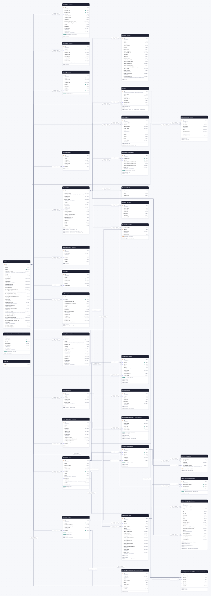

## Contents

| Table                                                   | Name in the database     | Description                                                                                                                                                                                                            |
| ------------------------------------------------------- | ------------------------ | ---------------------------------------------------------------------------------------------------------------------------------------------------------------------------------------------------------------------- |
| [users](#table-users)                                   | `user`                   |                                                                                                                                                                                                                        |
| [accounts](#table-accounts)                             | `account`                |                                                                                                                                                                                                                        |
| [sessions](#table-sessions)                             | `session`                |                                                                                                                                                                                                                        |
| [verificationTokens](#table-verificationTokens)         | `verificationToken`      |                                                                                                                                                                                                                        |
| [apiKeys](#table-apiKeys)                               | `apiKey`                 |                                                                                                                                                                                                                        |
| [bookmarks](#table-bookmarks)                           | `bookmarks`              |                                                                                                                                                                                                                        |
| [bookmarkLinks](#table-bookmarkLinks)                   | `bookmarkLinks`          |                                                                                                                                                                                                                        |
| [assets](#table-assets)                                 | `assets`                 |                                                                                                                                                                                                                        |
| [highlights](#table-highlights)                         | `highlights`             |                                                                                                                                                                                                                        |
| [userReadingProgress](#table-userReadingProgress)       | `userReadingProgress`    |                                                                                                                                                                                                                        |
| [bookmarkTexts](#table-bookmarkTexts)                   | `bookmarkTexts`          |                                                                                                                                                                                                                        |
| [bookmarkAssets](#table-bookmarkAssets)                 | `bookmarkAssets`         |                                                                                                                                                                                                                        |
| [bookmarkTags](#table-bookmarkTags)                     | `bookmarkTags`           |                                                                                                                                                                                                                        |
| [tagsOnBookmarks](#table-tagsOnBookmarks)               | `tagsOnBookmarks`        |                                                                                                                                                                                                                        |
| [bookmarkLists](#table-bookmarkLists)                   | `bookmarkLists`          |                                                                                                                                                                                                                        |
| [bookmarksInLists](#table-bookmarksInLists)             | `bookmarksInLists`       |                                                                                                                                                                                                                        |
| [listCollaborators](#table-listCollaborators)           | `listCollaborators`      |                                                                                                                                                                                                                        |
| [listInvitations](#table-listInvitations)               | `listInvitations`        |                                                                                                                                                                                                                        |
| [customPrompts](#table-customPrompts)                   | `customPrompts`          |                                                                                                                                                                                                                        |
| [chatSessions](#table-chatSessions)                     | `chatSessions`           |                                                                                                                                                                                                                        |
| [chatMessages](#table-chatMessages)                     | `chatMessages`           |                                                                                                                                                                                                                        |
| [rssFeedsTable](#table-rssFeedsTable)                   | `rssFeeds`               |                                                                                                                                                                                                                        |
| [webhooksTable](#table-webhooksTable)                   | `webhooks`               |                                                                                                                                                                                                                        |
| [rssFeedImportsTable](#table-rssFeedImportsTable)       | `rssFeedImports`         |                                                                                                                                                                                                                        |
| [backupsTable](#table-backupsTable)                     | `backups`                |                                                                                                                                                                                                                        |
| [config](#table-config)                                 | `config`                 |                                                                                                                                                                                                                        |
| [ruleEngineRulesTable](#table-ruleEngineRulesTable)     | `ruleEngineRules`        |                                                                                                                                                                                                                        |
| [ruleEngineActionsTable](#table-ruleEngineActionsTable) | `ruleEngineActions`      |                                                                                                                                                                                                                        |
| [invites](#table-invites)                               | `invites`                |                                                                                                                                                                                                                        |
| [subscriptions](#table-subscriptions)                   | `subscriptions`          |                                                                                                                                                                                                                        |
| [inAppSubscriptions](#table-inAppSubscriptions)         | `inAppSubscriptions`     | Subscriptions purchased through the mobile app stores (App Store / Google Play). These are managed by RevenueCat, which is the source of truth; this table mirrors the state of the configured RevenueCat entitlement. |
| [importSessions](#table-importSessions)                 | `importSessions`         |                                                                                                                                                                                                                        |
| [importSessionBookmarks](#table-importSessionBookmarks) | `importSessionBookmarks` |                                                                                                                                                                                                                        |
| [importStagingBookmarks](#table-importStagingBookmarks) | `importStagingBookmarks` |                                                                                                                                                                                                                        |

## Tables

<a id="table-users"></a>

### users

Table `user`.

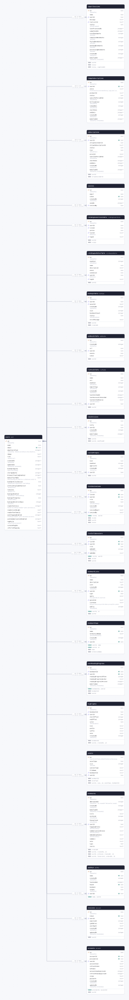

| Column                     | Type      | Constraints     | Default                          | Description                                                                                                                                                                                            |
| -------------------------- | --------- | --------------- | -------------------------------- | ------------------------------------------------------------------------------------------------------------------------------------------------------------------------------------------------------ |
| `id`                       | `text`    | PK NOT NULL     | `.$defaultFn()`                  |                                                                                                                                                                                                        |
| `name`                     | `text`    | NOT NULL        |                                  |                                                                                                                                                                                                        |
| `email`                    | `text`    | UNIQUE NOT NULL |                                  |                                                                                                                                                                                                        |
| `emailVerified`            | `integer` | NULL            | `.$defaultFn()`                  | Nullable and without a SQL default because SQLite can't add those constraints to an existing column without rebuilding the user table.                                                                 |
| `image`                    | `text`    | NULL            |                                  |                                                                                                                                                                                                        |
| `role`                     | `text`    | NULL            | `.default("user")`               |                                                                                                                                                                                                        |
| `createdAt`                | `integer` | NULL            | `.$defaultFn()`                  |                                                                                                                                                                                                        |
| `updatedAt`                | `integer` | NULL            | `.$defaultFn()` `.$onUpdate()`   |                                                                                                                                                                                                        |
| `bookmarkQuota`            | `integer` | NULL            |                                  | Admin Only Settings                                                                                                                                                                                    |
| `storageQuota`             | `integer` | NULL            |                                  |                                                                                                                                                                                                        |
| `browserCrawlingEnabled`   | `integer` | NULL            |                                  |                                                                                                                                                                                                        |
| `manualTierName`           | `text`    | NULL            |                                  | Admin-granted plan label (e.g. a collaborator name). While set, Stripe and in-app purchase syncs don't downgrade the user's entitlements; it's cleared when the user gets an active paid subscription. |
| `bookmarkClickAction`      | `text`    | NOT NULL        | `.default("open_original_link")` | User Settings                                                                                                                                                                                          |
| `archiveDisplayBehaviour`  | `text`    | NOT NULL        | `.default("show")`               |                                                                                                                                                                                                        |
| `timezone`                 | `text`    | NULL            | `.default("UTC")`                |                                                                                                                                                                                                        |
| `backupsEnabled`           | `integer` | NOT NULL        | `.default(false)`                | Backup Settings                                                                                                                                                                                        |
| `backupsFrequency`         | `text`    | NOT NULL        | `.default("weekly")`             |                                                                                                                                                                                                        |
| `backupsRetentionDays`     | `integer` | NOT NULL        | `.default(30)`                   |                                                                                                                                                                                                        |
| `readerFontSize`           | `integer` | NULL            |                                  | Reader view settings (nullable = opt-in, null means use client default)                                                                                                                                |
| `readerLineHeight`         | `real`    | NULL            |                                  |                                                                                                                                                                                                        |
| `readerFontFamily`         | `text`    | NULL            |                                  |                                                                                                                                                                                                        |
| `autoTaggingEnabled`       | `integer` | NULL            |                                  | AI Settings (nullable = opt-in, null means use server default)                                                                                                                                         |
| `autoSummarizationEnabled` | `integer` | NULL            |                                  |                                                                                                                                                                                                        |
| `tagStyle`                 | `text`    | NULL            | `.default("titlecase-spaces")`   |                                                                                                                                                                                                        |
| `curatedTagIds`            | `text`    | NULL            |                                  |                                                                                                                                                                                                        |
| `inferredTagLang`          | `text`    | NULL            |                                  |                                                                                                                                                                                                        |

#### Referenced by

- `id` → [accounts.userId](#table-accounts) (one to many, on delete cascade)
- `id` → [sessions.userId](#table-sessions) (one to many, on delete cascade)
- `id` → [apiKeys.userId](#table-apiKeys) (one to many, on delete cascade)
- `id` → [bookmarks.userId](#table-bookmarks) (one to many, on delete cascade)
- `id` → [assets.userId](#table-assets) (one to many, on delete cascade)
- `id` → [highlights.userId](#table-highlights) (one to many, on delete cascade)
- `id` → [userReadingProgress.userId](#table-userReadingProgress) (one to many, on delete cascade)
- `id` → [bookmarkTags.userId](#table-bookmarkTags) (one to many, on delete cascade)
- `id` → [bookmarkLists.userId](#table-bookmarkLists) (one to many, on delete cascade)
- `id` → [listCollaborators.userId](#table-listCollaborators) (one to many, on delete cascade)
- `id` → [listCollaborators.addedBy](#table-listCollaborators) (one to many, on delete set null)
- `id` → [listInvitations.userId](#table-listInvitations) (one to many, on delete cascade)
- `id` → [listInvitations.invitedBy](#table-listInvitations) (one to many, on delete set null)
- `id` → [customPrompts.userId](#table-customPrompts) (one to many, on delete cascade)
- `id` → [chatSessions.userId](#table-chatSessions) (one to many, on delete cascade)
- `id` → [rssFeedsTable.userId](#table-rssFeedsTable) (one to many, on delete cascade)
- `id` → [webhooksTable.userId](#table-webhooksTable) (one to many, on delete cascade)
- `id` → [backupsTable.userId](#table-backupsTable) (one to many, on delete cascade)
- `id` → [ruleEngineRulesTable.userId](#table-ruleEngineRulesTable) (one to many, on delete cascade)
- `id` → [ruleEngineActionsTable.userId](#table-ruleEngineActionsTable) (one to many, on delete cascade)
- `id` → [invites.invitedBy](#table-invites) (one to many, on delete cascade)
- `id` → [subscriptions.userId](#table-subscriptions) (one to one, on delete cascade)
- `id` → [inAppSubscriptions.userId](#table-inAppSubscriptions) (one to one, on delete cascade)
- `id` → [importSessions.userId](#table-importSessions) (one to many, on delete cascade)

<details>
<summary>Queries</summary>

**Select**: Every row of users.

```ts
db.select().from(users);
```

**Count**: How many rows users has.

```ts
db.$count(users);
```

**Find many**: The rows of users, through the relational query API.

```ts
db.query.users.findMany();
```

</details>

<a id="table-accounts"></a>

### accounts

Table `account`.

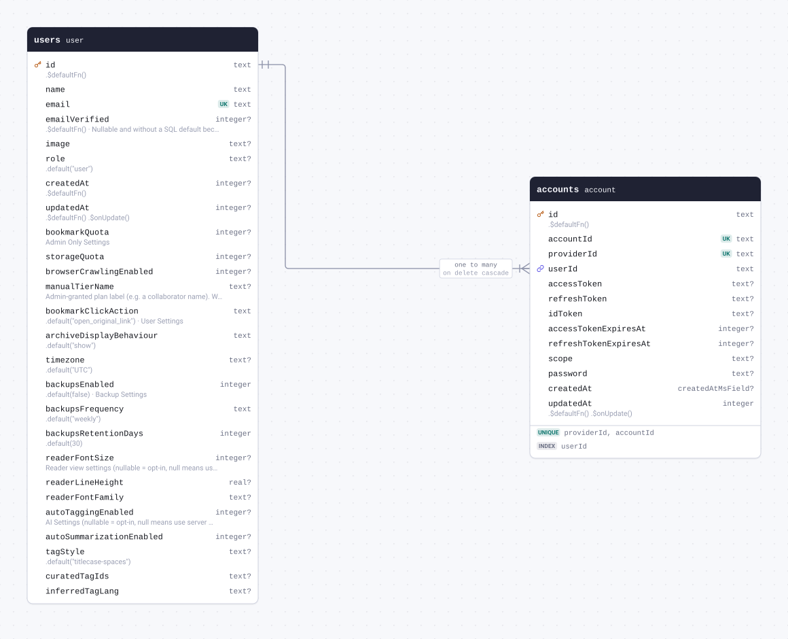

| Column                  | Type               | Constraints                         | Default                        | Description |
| ----------------------- | ------------------ | ----------------------------------- | ------------------------------ | ----------- |
| `id`                    | `text`             | PK NOT NULL                         | `.$defaultFn()`                |             |
| `accountId`             | `text`             | NOT NULL                            |                                |             |
| `providerId`            | `text`             | NOT NULL                            |                                |             |
| `userId`                | `text`             | NOT NULL → [users.id](#table-users) |                                |             |
| `accessToken`           | `text`             | NULL                                |                                |             |
| `refreshToken`          | `text`             | NULL                                |                                |             |
| `idToken`               | `text`             | NULL                                |                                |             |
| `accessTokenExpiresAt`  | `integer`          | NULL                                |                                |             |
| `refreshTokenExpiresAt` | `integer`          | NULL                                |                                |             |
| `scope`                 | `text`             | NULL                                |                                |             |
| `password`              | `text`             | NULL                                |                                |             |
| `createdAt`             | `createdAtMsField` | NULL                                |                                |             |
| `updatedAt`             | `integer`          | NOT NULL                            | `.$defaultFn()` `.$onUpdate()` |             |

#### Indexes

- UNIQUE `providerId`, `accountId`
- INDEX `userId`

#### References

- `userId` → [users.id](#table-users) (many to one, on delete cascade)

<details>
<summary>Queries</summary>

**Select**: Every row of accounts.

```ts
db.select().from(accounts);
```

**Count**: How many rows accounts has.

```ts
db.$count(accounts);
```

**Find many**: The rows of accounts, through the relational query API.

```ts
db.query.accounts.findMany();
```

</details>

<a id="table-sessions"></a>

### sessions

Table `session`.

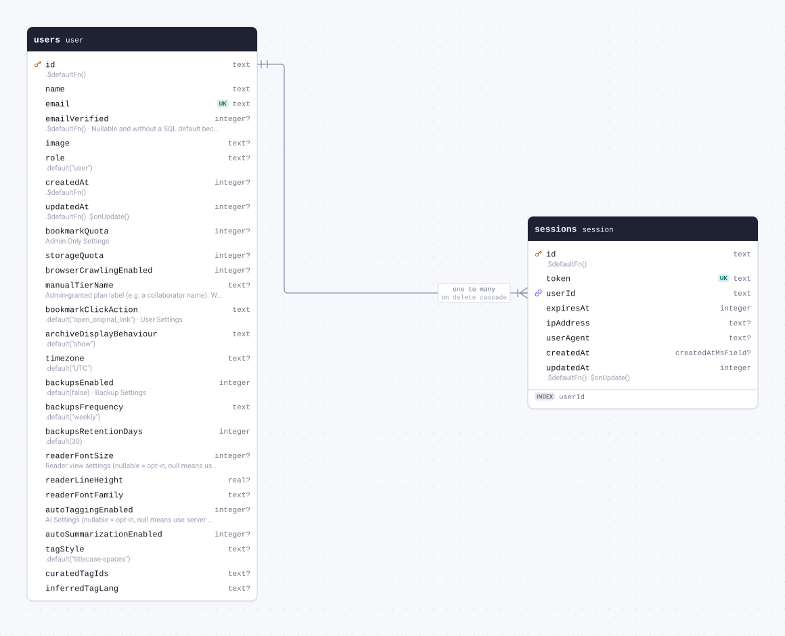

| Column      | Type               | Constraints                         | Default                        | Description |
| ----------- | ------------------ | ----------------------------------- | ------------------------------ | ----------- |
| `id`        | `text`             | PK NOT NULL                         | `.$defaultFn()`                |             |
| `token`     | `text`             | UNIQUE NOT NULL                     |                                |             |
| `userId`    | `text`             | NOT NULL → [users.id](#table-users) |                                |             |
| `expiresAt` | `integer`          | NOT NULL                            |                                |             |
| `ipAddress` | `text`             | NULL                                |                                |             |
| `userAgent` | `text`             | NULL                                |                                |             |
| `createdAt` | `createdAtMsField` | NULL                                |                                |             |
| `updatedAt` | `integer`          | NOT NULL                            | `.$defaultFn()` `.$onUpdate()` |             |

#### Indexes

- INDEX `userId`

#### References

- `userId` → [users.id](#table-users) (many to one, on delete cascade)

<details>
<summary>Queries</summary>

**Select**: Every row of sessions.

```ts
db.select().from(sessions);
```

**Count**: How many rows sessions has.

```ts
db.$count(sessions);
```

**Find many**: The rows of sessions, through the relational query API.

```ts
db.query.sessions.findMany();
```

</details>

<a id="table-verificationTokens"></a>

### verificationTokens

Table `verificationToken`.

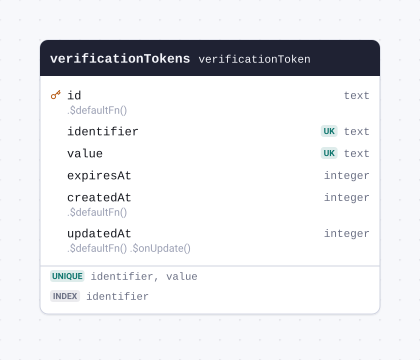

| Column       | Type               | Constraints | Default                        | Description |
| ------------ | ------------------ | ----------- | ------------------------------ | ----------- |
| `id`         | `text`             | PK NOT NULL | `.$defaultFn()`                |             |
| `identifier` | `text`             | NOT NULL    |                                |             |
| `value`      | `text`             | NOT NULL    |                                |             |
| `expiresAt`  | `integer`          | NOT NULL    |                                |             |
| `createdAt`  | `createdAtMsField` | NULL        |                                |             |
| `updatedAt`  | `integer`          | NOT NULL    | `.$defaultFn()` `.$onUpdate()` |             |

#### Indexes

- UNIQUE `identifier`, `value`
- INDEX `identifier`

<details>
<summary>Queries</summary>

**Select**: Every row of verificationTokens.

```ts
db.select().from(verificationTokens);
```

**Count**: How many rows verificationTokens has.

```ts
db.$count(verificationTokens);
```

**Find many**: The rows of verificationTokens, through the relational query API.

```ts
db.query.verificationTokens.findMany();
```

</details>

<a id="table-apiKeys"></a>

### apiKeys

Table `apiKey`.

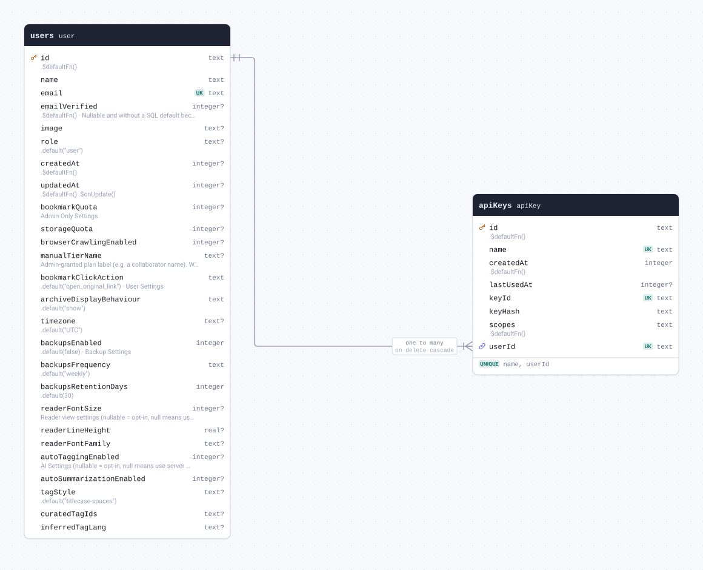

| Column       | Type             | Constraints                         | Default         | Description |
| ------------ | ---------------- | ----------------------------------- | --------------- | ----------- |
| `id`         | `text`           | PK NOT NULL                         | `.$defaultFn()` |             |
| `name`       | `text`           | NOT NULL                            |                 |             |
| `createdAt`  | `createdAtField` | NULL                                |                 |             |
| `lastUsedAt` | `integer`        | NULL                                |                 |             |
| `keyId`      | `text`           | UNIQUE NOT NULL                     |                 |             |
| `keyHash`    | `text`           | NOT NULL                            |                 |             |
| `scopes`     | `text`           | NOT NULL                            | `.$defaultFn()` |             |
| `userId`     | `text`           | NOT NULL → [users.id](#table-users) |                 |             |

#### Indexes

- UNIQUE `name`, `userId`

#### References

- `userId` → [users.id](#table-users) (many to one, on delete cascade)

<details>
<summary>Queries</summary>

**Select**: Every row of apiKeys.

```ts
db.select().from(apiKeys);
```

**Count**: How many rows apiKeys has.

```ts
db.$count(apiKeys);
```

**Find many**: The rows of apiKeys, through the relational query API.

```ts
db.query.apiKeys.findMany();
```

</details>

<a id="table-bookmarks"></a>

### bookmarks

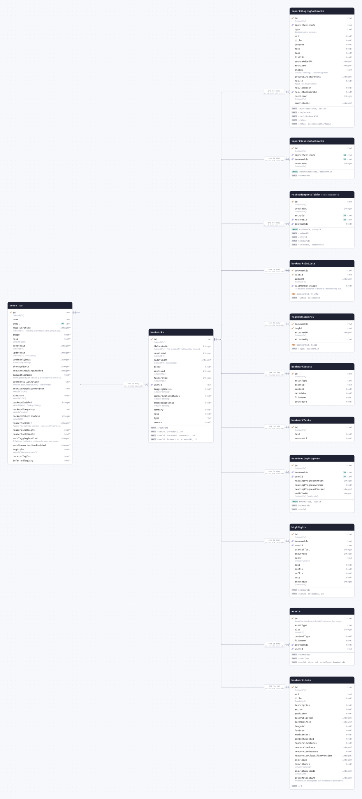

| Column                      | Type              | Constraints                         | Default               | Description                                                                                                                                                                                                                                                                                                                                                                                                                                                                                                                                             |
| --------------------------- | ----------------- | ----------------------------------- | --------------------- | ------------------------------------------------------------------------------------------------------------------------------------------------------------------------------------------------------------------------------------------------------------------------------------------------------------------------------------------------------------------------------------------------------------------------------------------------------------------------------------------------------------------------------------------------------- |
| `id`                        | `text`            | PK NOT NULL                         | `.$defaultFn()`       |                                                                                                                                                                                                                                                                                                                                                                                                                                                                                                                                                         |
| `dbCreatedAt`               | `createdAtField`  | NULL                                |                       | The `createdAt` field and the `createdAt` column intentionally don't match. Re-saving an existing bookmark bumps it back to the top of the list, so the timestamp everything sorts and filters on is now "when was this last saved" and lives in the `lastSavedAt` column. It keeps the `createdAt` field name because that's what the API has always exposed and what every query already orders by. The immutable "when did this row first appear" timestamp stays in the original `createdAt` column, and is exposed to clients as `firstCreatedAt`. |
| `createdAt` (`lastSavedAt`) | `createdAtField`  | NULL                                |                       |                                                                                                                                                                                                                                                                                                                                                                                                                                                                                                                                                         |
| `modifiedAt`                | `modifiedAtField` | NULL                                |                       |                                                                                                                                                                                                                                                                                                                                                                                                                                                                                                                                                         |
| `title`                     | `text`            | NULL                                |                       |                                                                                                                                                                                                                                                                                                                                                                                                                                                                                                                                                         |
| `archived`                  | `integer`         | NOT NULL                            | `.default(false)`     |                                                                                                                                                                                                                                                                                                                                                                                                                                                                                                                                                         |
| `favourited`                | `integer`         | NOT NULL                            | `.default(false)`     |                                                                                                                                                                                                                                                                                                                                                                                                                                                                                                                                                         |
| `userId`                    | `text`            | NOT NULL → [users.id](#table-users) |                       |                                                                                                                                                                                                                                                                                                                                                                                                                                                                                                                                                         |
| `taggingStatus`             | `text`            | NULL                                | `.default("pending")` |                                                                                                                                                                                                                                                                                                                                                                                                                                                                                                                                                         |
| `summarizationStatus`       | `text`            | NULL                                | `.default("pending")` |                                                                                                                                                                                                                                                                                                                                                                                                                                                                                                                                                         |
| `embeddingStatus`           | `text`            | NULL                                | `.default("pending")` |                                                                                                                                                                                                                                                                                                                                                                                                                                                                                                                                                         |
| `summary`                   | `text`            | NULL                                |                       |                                                                                                                                                                                                                                                                                                                                                                                                                                                                                                                                                         |
| `note`                      | `text`            | NULL                                |                       |                                                                                                                                                                                                                                                                                                                                                                                                                                                                                                                                                         |
| `type`                      | `text`            | NOT NULL                            |                       |                                                                                                                                                                                                                                                                                                                                                                                                                                                                                                                                                         |
| `source`                    | `text`            | NULL                                |                       |                                                                                                                                                                                                                                                                                                                                                                                                                                                                                                                                                         |

#### Indexes

- INDEX `createdAt`
- INDEX `userId`, `createdAt`, `id`
- INDEX `userId`, `archived`, `createdAt`, `id`
- INDEX `userId`, `favourited`, `createdAt`, `id`

#### References

- `userId` → [users.id](#table-users) (many to one, on delete cascade)

#### Referenced by

- `id` → [bookmarkLinks.id](#table-bookmarkLinks) (one to one, on delete cascade)
- `id` → [assets.bookmarkId](#table-assets) (one to many, on delete cascade)
- `id` → [highlights.bookmarkId](#table-highlights) (one to many, on delete cascade)
- `id` → [userReadingProgress.bookmarkId](#table-userReadingProgress) (one to many, on delete cascade)
- `id` → [bookmarkTexts.id](#table-bookmarkTexts) (one to one, on delete cascade)
- `id` → [bookmarkAssets.id](#table-bookmarkAssets) (one to one, on delete cascade)
- `id` → [tagsOnBookmarks.bookmarkId](#table-tagsOnBookmarks) (one to many, on delete cascade)
- `id` → [bookmarksInLists.bookmarkId](#table-bookmarksInLists) (one to many, on delete cascade)
- `id` → [rssFeedImportsTable.bookmarkId](#table-rssFeedImportsTable) (one to many, on delete set null)
- `id` → [importSessionBookmarks.bookmarkId](#table-importSessionBookmarks) (one to many, on delete cascade)
- `id` → [importStagingBookmarks.resultBookmarkId](#table-importStagingBookmarks) (one to many, on delete set null)

<details>
<summary>Queries</summary>

**Select**: Every row of bookmarks.

```ts
db.select().from(bookmarks);
```

**Count**: How many rows bookmarks has.

```ts
db.$count(bookmarks);
```

**Find many**: The rows of bookmarks, through the relational query API.

```ts
db.query.bookmarks.findMany();
```

</details>

<a id="table-bookmarkLinks"></a>

### bookmarkLinks

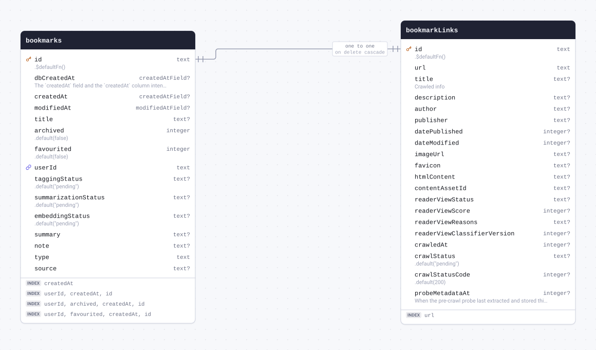

| Column                        | Type      | Constraints                                    | Default               | Description                                                                                                      |
| ----------------------------- | --------- | ---------------------------------------------- | --------------------- | ---------------------------------------------------------------------------------------------------------------- |
| `id`                          | `text`    | PK NOT NULL → [bookmarks.id](#table-bookmarks) | `.$defaultFn()`       |                                                                                                                  |
| `url`                         | `text`    | NOT NULL                                       |                       |                                                                                                                  |
| `title`                       | `text`    | NULL                                           |                       | Crawled info                                                                                                     |
| `description`                 | `text`    | NULL                                           |                       |                                                                                                                  |
| `author`                      | `text`    | NULL                                           |                       |                                                                                                                  |
| `publisher`                   | `text`    | NULL                                           |                       |                                                                                                                  |
| `datePublished`               | `integer` | NULL                                           |                       |                                                                                                                  |
| `dateModified`                | `integer` | NULL                                           |                       |                                                                                                                  |
| `imageUrl`                    | `text`    | NULL                                           |                       |                                                                                                                  |
| `favicon`                     | `text`    | NULL                                           |                       |                                                                                                                  |
| `htmlContent`                 | `text`    | NULL                                           |                       |                                                                                                                  |
| `contentAssetId`              | `text`    | NULL                                           |                       |                                                                                                                  |
| `readerViewStatus`            | `text`    | NULL                                           |                       |                                                                                                                  |
| `readerViewScore`             | `integer` | NULL                                           |                       |                                                                                                                  |
| `readerViewReasons`           | `text`    | NULL                                           |                       |                                                                                                                  |
| `readerViewClassifierVersion` | `integer` | NULL                                           |                       |                                                                                                                  |
| `crawledAt`                   | `integer` | NULL                                           |                       |                                                                                                                  |
| `crawlStatus`                 | `text`    | NULL                                           | `.default("pending")` |                                                                                                                  |
| `crawlStatusCode`             | `integer` | NULL                                           | `.default(200)`       |                                                                                                                  |
| `probeMetadataAt`             | `integer` | NULL                                           |                       | When the pre-crawl probe last extracted and stored this link's metadata. Lets crawl retries skip re-fetching it. |

#### Indexes

- INDEX `url`

#### References

- `id` → [bookmarks.id](#table-bookmarks) (one to one, on delete cascade)

<details>
<summary>Queries</summary>

**Select**: Every row of bookmarkLinks.

```ts
db.select().from(bookmarkLinks);
```

**Count**: How many rows bookmarkLinks has.

```ts
db.$count(bookmarkLinks);
```

**Find many**: The rows of bookmarkLinks, through the relational query API.

```ts
db.query.bookmarkLinks.findMany();
```

</details>

<a id="table-assets"></a>

### assets

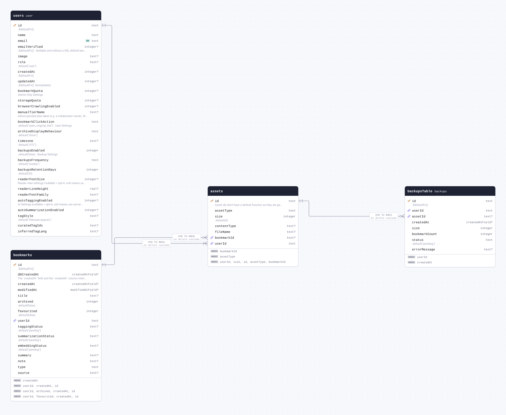

| Column        | Type      | Constraints                             | Default       | Description                                                                 |
| ------------- | --------- | --------------------------------------- | ------------- | --------------------------------------------------------------------------- |
| `id`          | `text`    | PK NOT NULL                             |               | Asset ids don't have a default function as they are generated by the caller |
| `assetType`   | `text`    | NOT NULL                                |               |                                                                             |
| `size`        | `integer` | NOT NULL                                | `.default(0)` |                                                                             |
| `contentType` | `text`    | NULL                                    |               |                                                                             |
| `fileName`    | `text`    | NULL                                    |               |                                                                             |
| `bookmarkId`  | `text`    | NULL → [bookmarks.id](#table-bookmarks) |               |                                                                             |
| `userId`      | `text`    | NOT NULL → [users.id](#table-users)     |               |                                                                             |

#### Indexes

- INDEX `bookmarkId`
- INDEX `assetType`
- INDEX `userId`, `size`, `id`, `assetType`, `bookmarkId`

#### References

- `bookmarkId` → [bookmarks.id](#table-bookmarks) (many to one, on delete cascade)
- `userId` → [users.id](#table-users) (many to one, on delete cascade)

#### Referenced by

- `id` → [backupsTable.assetId](#table-backupsTable) (one to many, on delete cascade)

<details>
<summary>Queries</summary>

**Select**: Every row of assets.

```ts
db.select().from(assets);
```

**Count**: How many rows assets has.

```ts
db.$count(assets);
```

**Find many**: The rows of assets, through the relational query API.

```ts
db.query.assets.findMany();
```

</details>

<a id="table-highlights"></a>

### highlights

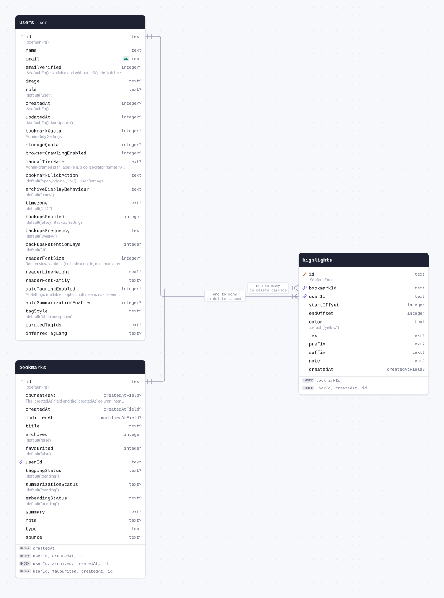

| Column        | Type             | Constraints                                 | Default              | Description |
| ------------- | ---------------- | ------------------------------------------- | -------------------- | ----------- |
| `id`          | `text`           | PK NOT NULL                                 | `.$defaultFn()`      |             |
| `bookmarkId`  | `text`           | NOT NULL → [bookmarks.id](#table-bookmarks) |                      |             |
| `userId`      | `text`           | NOT NULL → [users.id](#table-users)         |                      |             |
| `startOffset` | `integer`        | NOT NULL                                    |                      |             |
| `endOffset`   | `integer`        | NOT NULL                                    |                      |             |
| `color`       | `text`           | NOT NULL                                    | `.default("yellow")` |             |
| `text`        | `text`           | NULL                                        |                      |             |
| `prefix`      | `text`           | NULL                                        |                      |             |
| `suffix`      | `text`           | NULL                                        |                      |             |
| `note`        | `text`           | NULL                                        |                      |             |
| `createdAt`   | `createdAtField` | NULL                                        |                      |             |

#### Indexes

- INDEX `bookmarkId`
- INDEX `userId`, `createdAt`, `id`

#### References

- `bookmarkId` → [bookmarks.id](#table-bookmarks) (many to one, on delete cascade)
- `userId` → [users.id](#table-users) (many to one, on delete cascade)

<details>
<summary>Queries</summary>

**Select**: Every row of highlights.

```ts
db.select().from(highlights);
```

**Count**: How many rows highlights has.

```ts
db.$count(highlights);
```

**Find many**: The rows of highlights, through the relational query API.

```ts
db.query.highlights.findMany();
```

</details>

<a id="table-userReadingProgress"></a>

### userReadingProgress

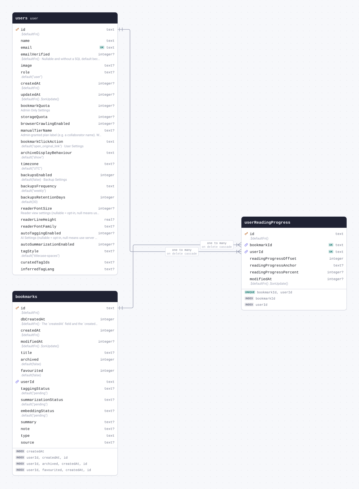

| Column                   | Type              | Constraints                                 | Default         | Description |
| ------------------------ | ----------------- | ------------------------------------------- | --------------- | ----------- |
| `id`                     | `text`            | PK NOT NULL                                 | `.$defaultFn()` |             |
| `bookmarkId`             | `text`            | NOT NULL → [bookmarks.id](#table-bookmarks) |                 |             |
| `userId`                 | `text`            | NOT NULL → [users.id](#table-users)         |                 |             |
| `readingProgressOffset`  | `integer`         | NOT NULL                                    |                 |             |
| `readingProgressAnchor`  | `text`            | NULL                                        |                 |             |
| `readingProgressPercent` | `integer`         | NULL                                        |                 |             |
| `modifiedAt`             | `modifiedAtField` | NULL                                        |                 |             |

#### Indexes

- UNIQUE `bookmarkId`, `userId`
- INDEX `bookmarkId`
- INDEX `userId`

#### References

- `bookmarkId` → [bookmarks.id](#table-bookmarks) (many to one, on delete cascade)
- `userId` → [users.id](#table-users) (many to one, on delete cascade)

<details>
<summary>Queries</summary>

**Select**: Every row of userReadingProgress.

```ts
db.select().from(userReadingProgress);
```

**Count**: How many rows userReadingProgress has.

```ts
db.$count(userReadingProgress);
```

**Find many**: The rows of userReadingProgress, through the relational query API.

```ts
db.query.userReadingProgress.findMany();
```

</details>

<a id="table-bookmarkTexts"></a>

### bookmarkTexts

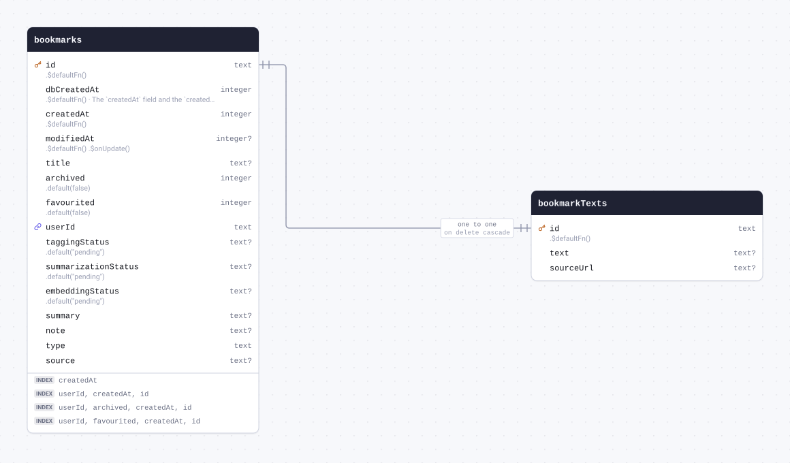

| Column      | Type   | Constraints                                    | Default         | Description |
| ----------- | ------ | ---------------------------------------------- | --------------- | ----------- |
| `id`        | `text` | PK NOT NULL → [bookmarks.id](#table-bookmarks) | `.$defaultFn()` |             |
| `text`      | `text` | NULL                                           |                 |             |
| `sourceUrl` | `text` | NULL                                           |                 |             |

#### References

- `id` → [bookmarks.id](#table-bookmarks) (one to one, on delete cascade)

<details>
<summary>Queries</summary>

**Select**: Every row of bookmarkTexts.

```ts
db.select().from(bookmarkTexts);
```

**Count**: How many rows bookmarkTexts has.

```ts
db.$count(bookmarkTexts);
```

**Find many**: The rows of bookmarkTexts, through the relational query API.

```ts
db.query.bookmarkTexts.findMany();
```

</details>

<a id="table-bookmarkAssets"></a>

### bookmarkAssets

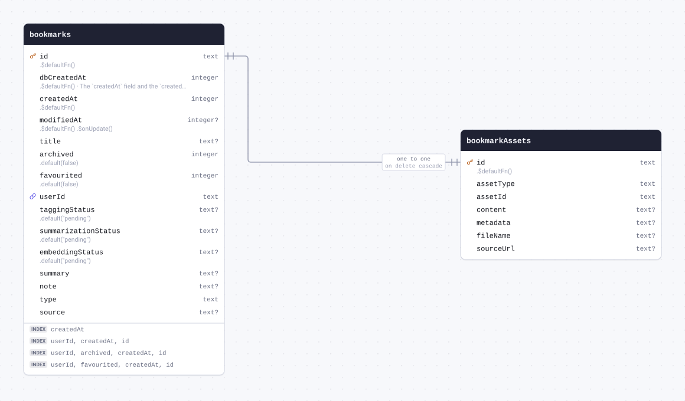

| Column      | Type   | Constraints                                    | Default         | Description |
| ----------- | ------ | ---------------------------------------------- | --------------- | ----------- |
| `id`        | `text` | PK NOT NULL → [bookmarks.id](#table-bookmarks) | `.$defaultFn()` |             |
| `assetType` | `text` | NOT NULL                                       |                 |             |
| `assetId`   | `text` | NOT NULL                                       |                 |             |
| `content`   | `text` | NULL                                           |                 |             |
| `metadata`  | `text` | NULL                                           |                 |             |
| `fileName`  | `text` | NULL                                           |                 |             |
| `sourceUrl` | `text` | NULL                                           |                 |             |

#### References

- `id` → [bookmarks.id](#table-bookmarks) (one to one, on delete cascade)

<details>
<summary>Queries</summary>

**Select**: Every row of bookmarkAssets.

```ts
db.select().from(bookmarkAssets);
```

**Count**: How many rows bookmarkAssets has.

```ts
db.$count(bookmarkAssets);
```

**Find many**: The rows of bookmarkAssets, through the relational query API.

```ts
db.query.bookmarkAssets.findMany();
```

</details>

<a id="table-bookmarkTags"></a>

### bookmarkTags

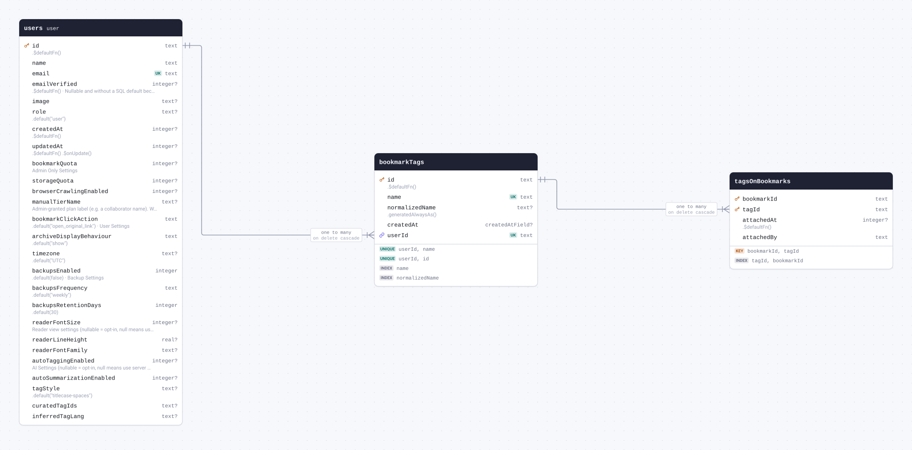

| Column           | Type             | Constraints                         | Default                | Description |
| ---------------- | ---------------- | ----------------------------------- | ---------------------- | ----------- |
| `id`             | `text`           | PK NOT NULL                         | `.$defaultFn()`        |             |
| `name`           | `text`           | NOT NULL                            |                        |             |
| `normalizedName` | `text`           | NULL                                | `.generatedAlwaysAs()` |             |
| `createdAt`      | `createdAtField` | NULL                                |                        |             |
| `userId`         | `text`           | NOT NULL → [users.id](#table-users) |                        |             |

#### Indexes

- UNIQUE `userId`, `name`
- UNIQUE `userId`, `id`
- INDEX `name`
- INDEX `normalizedName`

#### References

- `userId` → [users.id](#table-users) (many to one, on delete cascade)

#### Referenced by

- `id` → [tagsOnBookmarks.tagId](#table-tagsOnBookmarks) (one to many, on delete cascade)

<details>
<summary>Queries</summary>

**Select**: Every row of bookmarkTags.

```ts
db.select().from(bookmarkTags);
```

**Count**: How many rows bookmarkTags has.

```ts
db.$count(bookmarkTags);
```

**Find many**: The rows of bookmarkTags, through the relational query API.

```ts
db.query.bookmarkTags.findMany();
```

</details>

<a id="table-tagsOnBookmarks"></a>

### tagsOnBookmarks

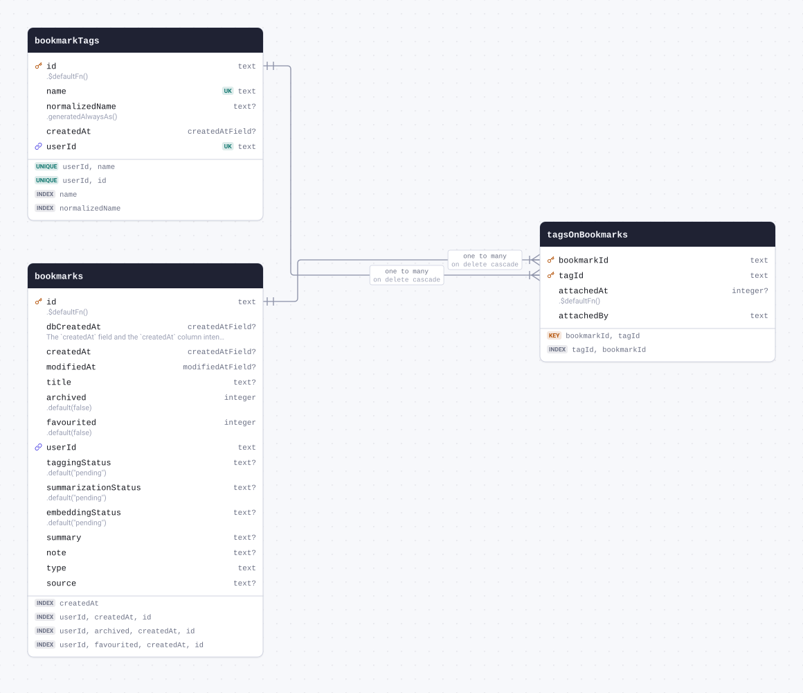

| Column       | Type      | Constraints                                          | Default         | Description |
| ------------ | --------- | ---------------------------------------------------- | --------------- | ----------- |
| `bookmarkId` | `text`    | PK NOT NULL → [bookmarks.id](#table-bookmarks)       |                 |             |
| `tagId`      | `text`    | PK NOT NULL → [bookmarkTags.id](#table-bookmarkTags) |                 |             |
| `attachedAt` | `integer` | NULL                                                 | `.$defaultFn()` |             |
| `attachedBy` | `text`    | NOT NULL                                             |                 |             |

#### Indexes

- PRIMARY KEY `bookmarkId`, `tagId`
- INDEX `tagId`, `bookmarkId`

#### References

- `bookmarkId` → [bookmarks.id](#table-bookmarks) (many to one, on delete cascade)
- `tagId` → [bookmarkTags.id](#table-bookmarkTags) (many to one, on delete cascade)

<details>
<summary>Queries</summary>

**Select**: Every row of tagsOnBookmarks.

```ts
db.select().from(tagsOnBookmarks);
```

**Count**: How many rows tagsOnBookmarks has.

```ts
db.$count(tagsOnBookmarks);
```

**Find many**: The rows of tagsOnBookmarks, through the relational query API.

```ts
db.query.tagsOnBookmarks.findMany();
```

</details>

<a id="table-bookmarkLists"></a>

### bookmarkLists

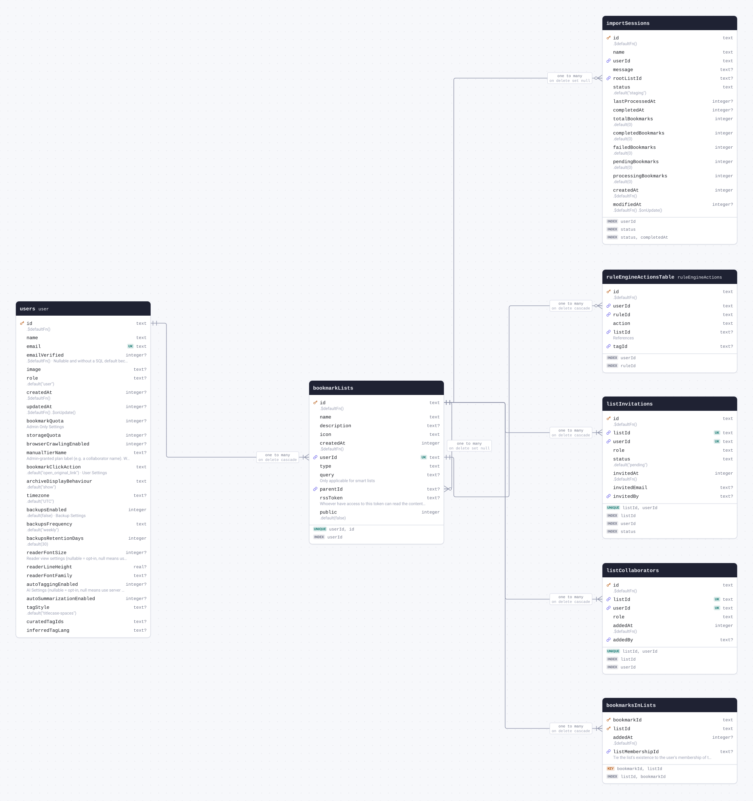

| Column        | Type             | Constraints                                     | Default           | Description                                                         |
| ------------- | ---------------- | ----------------------------------------------- | ----------------- | ------------------------------------------------------------------- |
| `id`          | `text`           | PK NOT NULL                                     | `.$defaultFn()`   |                                                                     |
| `name`        | `text`           | NOT NULL                                        |                   |                                                                     |
| `description` | `text`           | NULL                                            |                   |                                                                     |
| `icon`        | `text`           | NOT NULL                                        |                   |                                                                     |
| `createdAt`   | `createdAtField` | NULL                                            |                   |                                                                     |
| `userId`      | `text`           | NOT NULL → [users.id](#table-users)             |                   |                                                                     |
| `type`        | `text`           | NOT NULL                                        |                   |                                                                     |
| `query`       | `text`           | NULL                                            |                   | Only applicable for smart lists                                     |
| `parentId`    | `text`           | NULL → [bookmarkLists.id](#table-bookmarkLists) |                   |                                                                     |
| `rssToken`    | `text`           | NULL                                            |                   | Whoever have access to this token can read the content of this list |
| `public`      | `integer`        | NOT NULL                                        | `.default(false)` |                                                                     |

#### Indexes

- INDEX `userId`
- UNIQUE `userId`, `id`

#### References

- `userId` → [users.id](#table-users) (many to one, on delete cascade)
- `parentId` → [bookmarkLists.id](#table-bookmarkLists) (many to one, on delete set null)

#### Referenced by

- `id` → [bookmarkLists.parentId](#table-bookmarkLists) (one to many, on delete set null)
- `id` → [bookmarksInLists.listId](#table-bookmarksInLists) (one to many, on delete cascade)
- `id` → [listCollaborators.listId](#table-listCollaborators) (one to many, on delete cascade)
- `id` → [listInvitations.listId](#table-listInvitations) (one to many, on delete cascade)
- `id` → [importSessions.rootListId](#table-importSessions) (one to many, on delete set null)

<details>
<summary>Queries</summary>

**Select**: Every row of bookmarkLists.

```ts
db.select().from(bookmarkLists);
```

**Count**: How many rows bookmarkLists has.

```ts
db.$count(bookmarkLists);
```

**Find many**: The rows of bookmarkLists, through the relational query API.

```ts
db.query.bookmarkLists.findMany();
```

</details>

<a id="table-bookmarksInLists"></a>

### bookmarksInLists

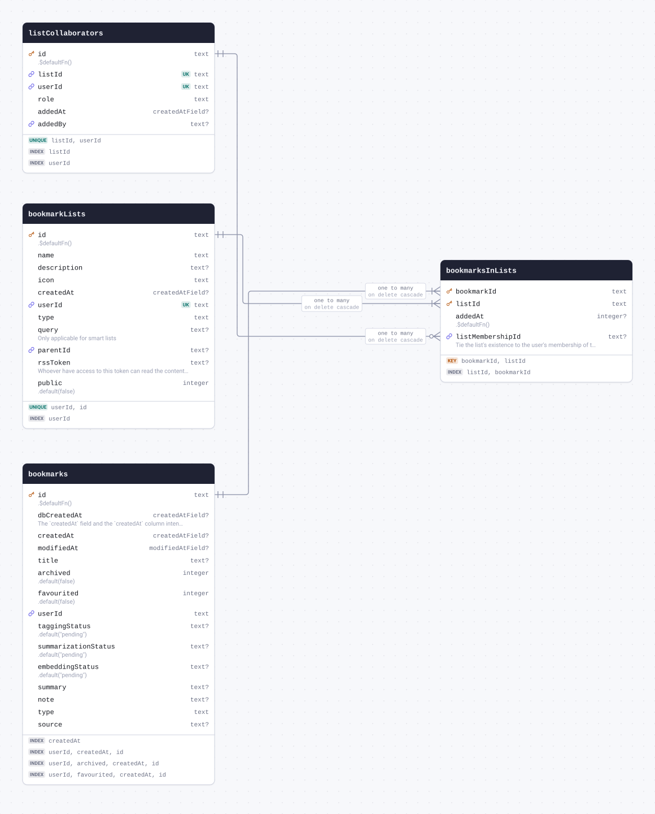

| Column             | Type      | Constraints                                             | Default         | Description                                                     |
| ------------------ | --------- | ------------------------------------------------------- | --------------- | --------------------------------------------------------------- |
| `bookmarkId`       | `text`    | PK NOT NULL → [bookmarks.id](#table-bookmarks)          |                 |                                                                 |
| `listId`           | `text`    | PK NOT NULL → [bookmarkLists.id](#table-bookmarkLists)  |                 |                                                                 |
| `addedAt`          | `integer` | NULL                                                    | `.$defaultFn()` |                                                                 |
| `listMembershipId` | `text`    | NULL → [listCollaborators.id](#table-listCollaborators) |                 | Tie the list's existence to the user's membership of this list. |

#### Indexes

- PRIMARY KEY `bookmarkId`, `listId`
- INDEX `listId`, `bookmarkId`

#### References

- `bookmarkId` → [bookmarks.id](#table-bookmarks) (many to one, on delete cascade)
- `listId` → [bookmarkLists.id](#table-bookmarkLists) (many to one, on delete cascade)
- `listMembershipId` → [listCollaborators.id](#table-listCollaborators) (many to one, on delete cascade)

<details>
<summary>Queries</summary>

**Select**: Every row of bookmarksInLists.

```ts
db.select().from(bookmarksInLists);
```

**Count**: How many rows bookmarksInLists has.

```ts
db.$count(bookmarksInLists);
```

**Find many**: The rows of bookmarksInLists, through the relational query API.

```ts
db.query.bookmarksInLists.findMany();
```

</details>

<a id="table-listCollaborators"></a>

### listCollaborators

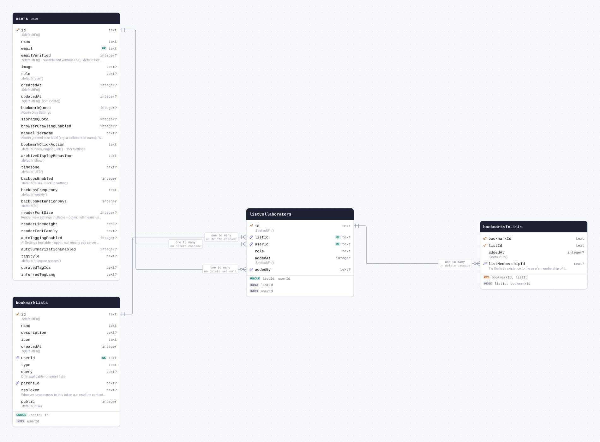

| Column    | Type             | Constraints                                         | Default         | Description |
| --------- | ---------------- | --------------------------------------------------- | --------------- | ----------- |
| `id`      | `text`           | PK NOT NULL                                         | `.$defaultFn()` |             |
| `listId`  | `text`           | NOT NULL → [bookmarkLists.id](#table-bookmarkLists) |                 |             |
| `userId`  | `text`           | NOT NULL → [users.id](#table-users)                 |                 |             |
| `role`    | `text`           | NOT NULL                                            |                 |             |
| `addedAt` | `createdAtField` | NULL                                                |                 |             |
| `addedBy` | `text`           | NULL → [users.id](#table-users)                     |                 |             |

#### Indexes

- UNIQUE `listId`, `userId`
- INDEX `listId`
- INDEX `userId`

#### References

- `listId` → [bookmarkLists.id](#table-bookmarkLists) (many to one, on delete cascade)
- `userId` → [users.id](#table-users) (many to one, on delete cascade)
- `addedBy` → [users.id](#table-users) (many to one, on delete set null)

#### Referenced by

- `id` → [bookmarksInLists.listMembershipId](#table-bookmarksInLists) (one to many, on delete cascade)

<details>
<summary>Queries</summary>

**Select**: Every row of listCollaborators.

```ts
db.select().from(listCollaborators);
```

**Count**: How many rows listCollaborators has.

```ts
db.$count(listCollaborators);
```

**Find many**: The rows of listCollaborators, through the relational query API.

```ts
db.query.listCollaborators.findMany();
```

</details>

<a id="table-listInvitations"></a>

### listInvitations

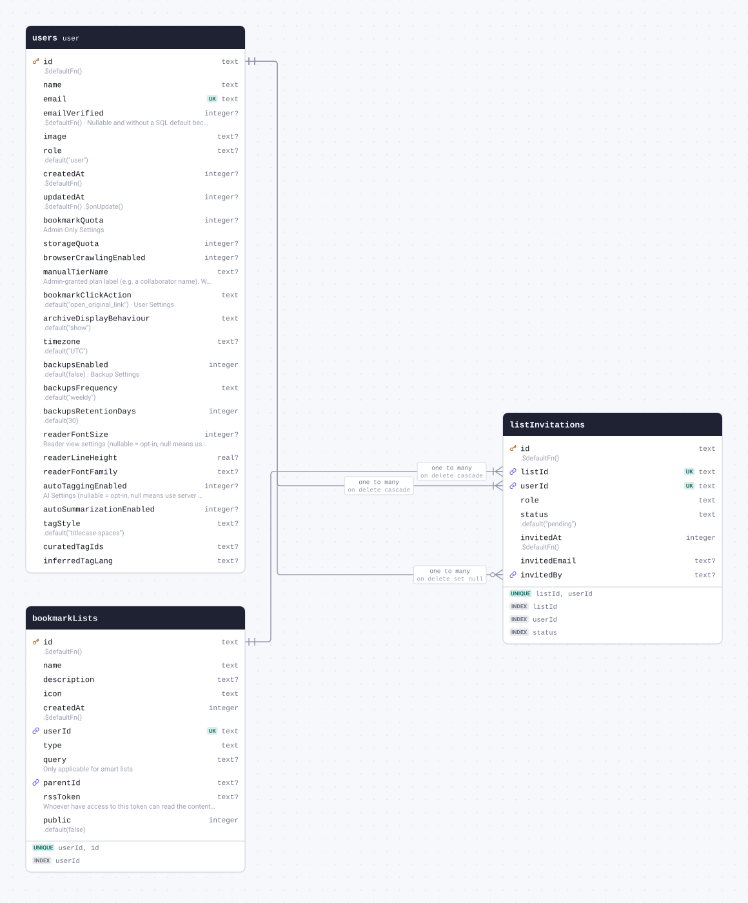

| Column         | Type      | Constraints                                         | Default               | Description |
| -------------- | --------- | --------------------------------------------------- | --------------------- | ----------- |
| `id`           | `text`    | PK NOT NULL                                         | `.$defaultFn()`       |             |
| `listId`       | `text`    | NOT NULL → [bookmarkLists.id](#table-bookmarkLists) |                       |             |
| `userId`       | `text`    | NOT NULL → [users.id](#table-users)                 |                       |             |
| `role`         | `text`    | NOT NULL                                            |                       |             |
| `status`       | `text`    | NOT NULL                                            | `.default("pending")` |             |
| `invitedAt`    | `integer` | NOT NULL                                            | `.$defaultFn()`       |             |
| `invitedEmail` | `text`    | NULL                                                |                       |             |
| `invitedBy`    | `text`    | NULL → [users.id](#table-users)                     |                       |             |

#### Indexes

- UNIQUE `listId`, `userId`
- INDEX `listId`
- INDEX `userId`
- INDEX `status`

#### References

- `listId` → [bookmarkLists.id](#table-bookmarkLists) (many to one, on delete cascade)
- `userId` → [users.id](#table-users) (many to one, on delete cascade)
- `invitedBy` → [users.id](#table-users) (many to one, on delete set null)

<details>
<summary>Queries</summary>

**Select**: Every row of listInvitations.

```ts
db.select().from(listInvitations);
```

**Count**: How many rows listInvitations has.

```ts
db.$count(listInvitations);
```

**Find many**: The rows of listInvitations, through the relational query API.

```ts
db.query.listInvitations.findMany();
```

</details>

<a id="table-customPrompts"></a>

### customPrompts

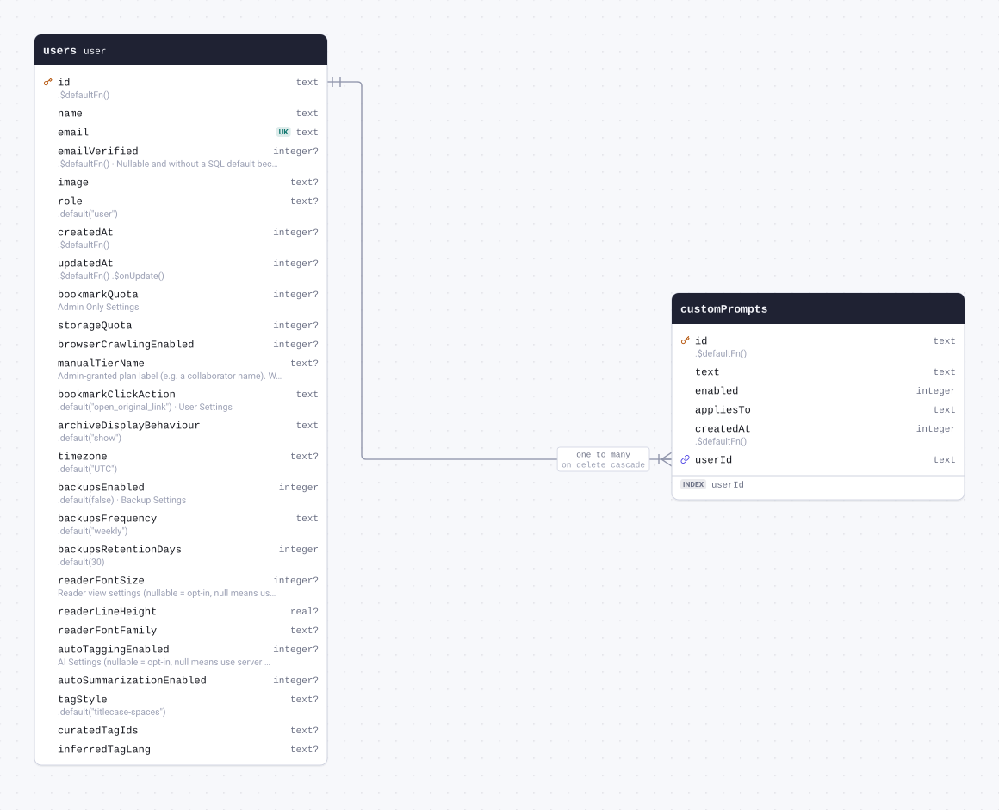

| Column      | Type             | Constraints                         | Default         | Description |
| ----------- | ---------------- | ----------------------------------- | --------------- | ----------- |
| `id`        | `text`           | PK NOT NULL                         | `.$defaultFn()` |             |
| `text`      | `text`           | NOT NULL                            |                 |             |
| `enabled`   | `integer`        | NOT NULL                            |                 |             |
| `appliesTo` | `text`           | NOT NULL                            |                 |             |
| `createdAt` | `createdAtField` | NULL                                |                 |             |
| `userId`    | `text`           | NOT NULL → [users.id](#table-users) |                 |             |

#### Indexes

- INDEX `userId`

#### References

- `userId` → [users.id](#table-users) (many to one, on delete cascade)

<details>
<summary>Queries</summary>

**Select**: Every row of customPrompts.

```ts
db.select().from(customPrompts);
```

**Count**: How many rows customPrompts has.

```ts
db.$count(customPrompts);
```

**Find many**: The rows of customPrompts, through the relational query API.

```ts
db.query.customPrompts.findMany();
```

</details>

<a id="table-chatSessions"></a>

### chatSessions

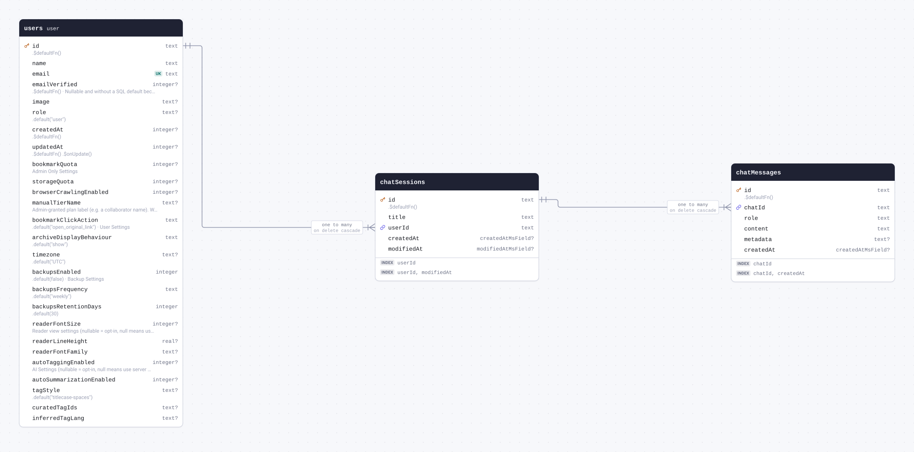

| Column       | Type                | Constraints                         | Default         | Description |
| ------------ | ------------------- | ----------------------------------- | --------------- | ----------- |
| `id`         | `text`              | PK NOT NULL                         | `.$defaultFn()` |             |
| `title`      | `text`              | NOT NULL                            |                 |             |
| `userId`     | `text`              | NOT NULL → [users.id](#table-users) |                 |             |
| `createdAt`  | `createdAtMsField`  | NULL                                |                 |             |
| `modifiedAt` | `modifiedAtMsField` | NULL                                |                 |             |

#### Indexes

- INDEX `userId`
- INDEX `userId`, `modifiedAt`

#### References

- `userId` → [users.id](#table-users) (many to one, on delete cascade)

#### Referenced by

- `id` → [chatMessages.chatId](#table-chatMessages) (one to many, on delete cascade)

<details>
<summary>Queries</summary>

**Select**: Every row of chatSessions.

```ts
db.select().from(chatSessions);
```

**Count**: How many rows chatSessions has.

```ts
db.$count(chatSessions);
```

**Find many**: The rows of chatSessions, through the relational query API.

```ts
db.query.chatSessions.findMany();
```

</details>

<a id="table-chatMessages"></a>

### chatMessages

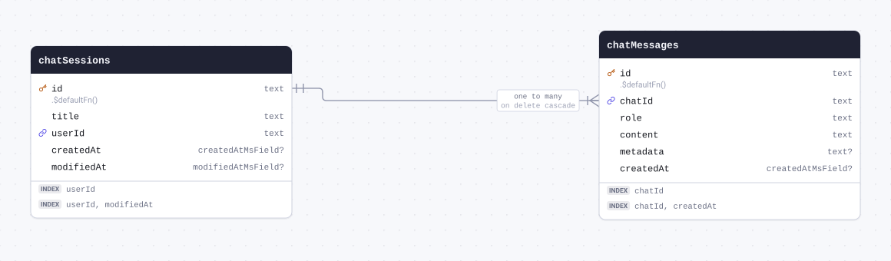

| Column      | Type               | Constraints                                       | Default         | Description |
| ----------- | ------------------ | ------------------------------------------------- | --------------- | ----------- |
| `id`        | `text`             | PK NOT NULL                                       | `.$defaultFn()` |             |
| `chatId`    | `text`             | NOT NULL → [chatSessions.id](#table-chatSessions) |                 |             |
| `role`      | `text`             | NOT NULL                                          |                 |             |
| `content`   | `text`             | NOT NULL                                          |                 |             |
| `metadata`  | `text`             | NULL                                              |                 |             |
| `createdAt` | `createdAtMsField` | NULL                                              |                 |             |

#### Indexes

- INDEX `chatId`
- INDEX `chatId`, `createdAt`

#### References

- `chatId` → [chatSessions.id](#table-chatSessions) (many to one, on delete cascade)

<details>
<summary>Queries</summary>

**Select**: Every row of chatMessages.

```ts
db.select().from(chatMessages);
```

**Count**: How many rows chatMessages has.

```ts
db.$count(chatMessages);
```

**Find many**: The rows of chatMessages, through the relational query API.

```ts
db.query.chatMessages.findMany();
```

</details>

<a id="table-rssFeedsTable"></a>

### rssFeedsTable

Table `rssFeeds`.

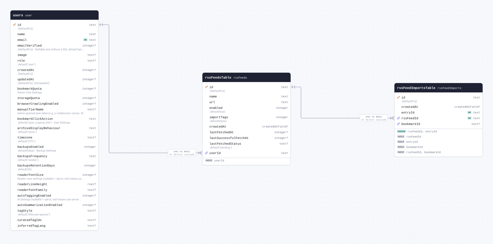

| Column                  | Type             | Constraints                         | Default               | Description |
| ----------------------- | ---------------- | ----------------------------------- | --------------------- | ----------- |
| `id`                    | `text`           | PK NOT NULL                         | `.$defaultFn()`       |             |
| `name`                  | `text`           | NOT NULL                            |                       |             |
| `url`                   | `text`           | NOT NULL                            |                       |             |
| `enabled`               | `integer`        | NOT NULL                            | `.default(true)`      |             |
| `importTags`            | `integer`        | NOT NULL                            | `.default(false)`     |             |
| `createdAt`             | `createdAtField` | NULL                                |                       |             |
| `lastFetchedAt`         | `integer`        | NULL                                |                       |             |
| `lastSuccessfulFetchAt` | `integer`        | NULL                                |                       |             |
| `lastFetchedStatus`     | `text`           | NULL                                | `.default("pending")` |             |
| `userId`                | `text`           | NOT NULL → [users.id](#table-users) |                       |             |

#### Indexes

- INDEX `userId`

#### References

- `userId` → [users.id](#table-users) (many to one, on delete cascade)

#### Referenced by

- `id` → [rssFeedImportsTable.rssFeedId](#table-rssFeedImportsTable) (one to many, on delete cascade)

<details>
<summary>Queries</summary>

**Select**: Every row of rssFeedsTable.

```ts
db.select().from(rssFeedsTable);
```

**Count**: How many rows rssFeedsTable has.

```ts
db.$count(rssFeedsTable);
```

**Find many**: The rows of rssFeedsTable, through the relational query API.

```ts
db.query.rssFeedsTable.findMany();
```

</details>

<a id="table-webhooksTable"></a>

### webhooksTable

Table `webhooks`.

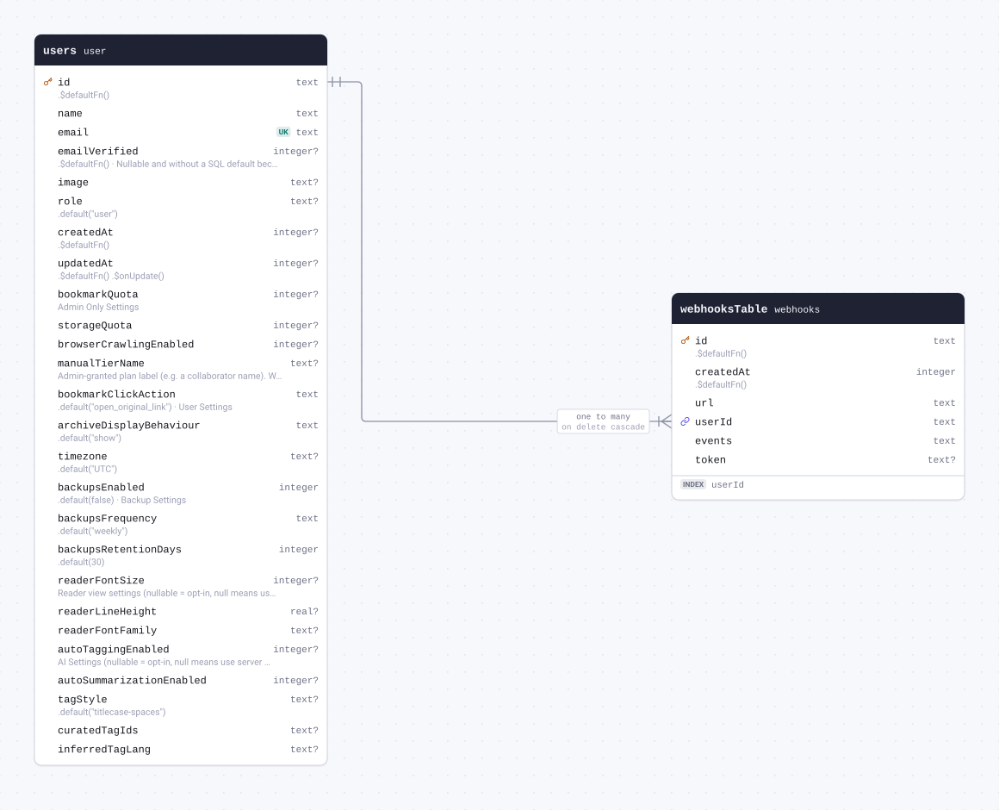

| Column      | Type             | Constraints                         | Default         | Description |
| ----------- | ---------------- | ----------------------------------- | --------------- | ----------- |
| `id`        | `text`           | PK NOT NULL                         | `.$defaultFn()` |             |
| `createdAt` | `createdAtField` | NULL                                |                 |             |
| `url`       | `text`           | NOT NULL                            |                 |             |
| `userId`    | `text`           | NOT NULL → [users.id](#table-users) |                 |             |
| `events`    | `text`           | NOT NULL                            |                 |             |
| `token`     | `text`           | NULL                                |                 |             |

#### Indexes

- INDEX `userId`

#### References

- `userId` → [users.id](#table-users) (many to one, on delete cascade)

<details>
<summary>Queries</summary>

**Select**: Every row of webhooksTable.

```ts
db.select().from(webhooksTable);
```

**Count**: How many rows webhooksTable has.

```ts
db.$count(webhooksTable);
```

**Find many**: The rows of webhooksTable, through the relational query API.

```ts
db.query.webhooksTable.findMany();
```

</details>

<a id="table-rssFeedImportsTable"></a>

### rssFeedImportsTable

Table `rssFeedImports`.

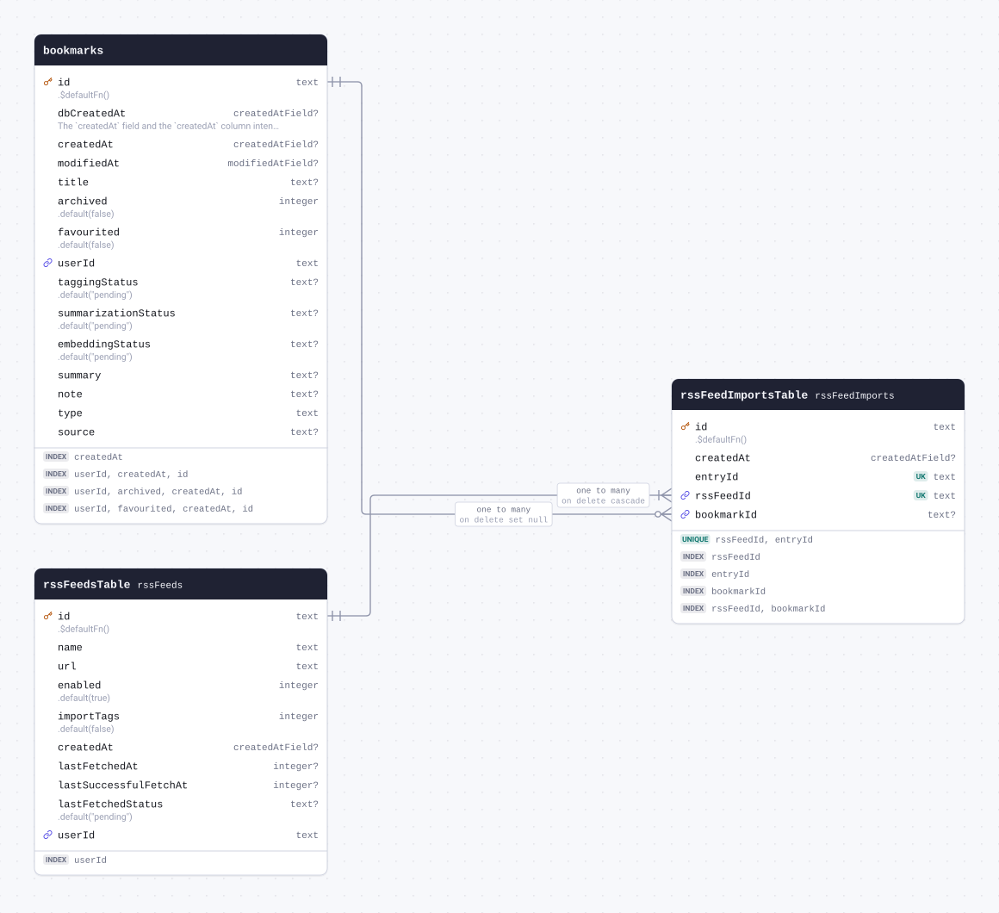

| Column       | Type             | Constraints                                         | Default         | Description |
| ------------ | ---------------- | --------------------------------------------------- | --------------- | ----------- |
| `id`         | `text`           | PK NOT NULL                                         | `.$defaultFn()` |             |
| `createdAt`  | `createdAtField` | NULL                                                |                 |             |
| `entryId`    | `text`           | NOT NULL                                            |                 |             |
| `rssFeedId`  | `text`           | NOT NULL → [rssFeedsTable.id](#table-rssFeedsTable) |                 |             |
| `bookmarkId` | `text`           | NULL → [bookmarks.id](#table-bookmarks)             |                 |             |

#### Indexes

- INDEX `rssFeedId`
- INDEX `entryId`
- UNIQUE `rssFeedId`, `entryId`
- INDEX `bookmarkId`
- INDEX `rssFeedId`, `bookmarkId`

#### References

- `rssFeedId` → [rssFeedsTable.id](#table-rssFeedsTable) (many to one, on delete cascade)
- `bookmarkId` → [bookmarks.id](#table-bookmarks) (many to one, on delete set null)

<details>
<summary>Queries</summary>

**Select**: Every row of rssFeedImportsTable.

```ts
db.select().from(rssFeedImportsTable);
```

**Count**: How many rows rssFeedImportsTable has.

```ts
db.$count(rssFeedImportsTable);
```

**Find many**: The rows of rssFeedImportsTable, through the relational query API.

```ts
db.query.rssFeedImportsTable.findMany();
```

</details>

<a id="table-backupsTable"></a>

### backupsTable

Table `backups`.

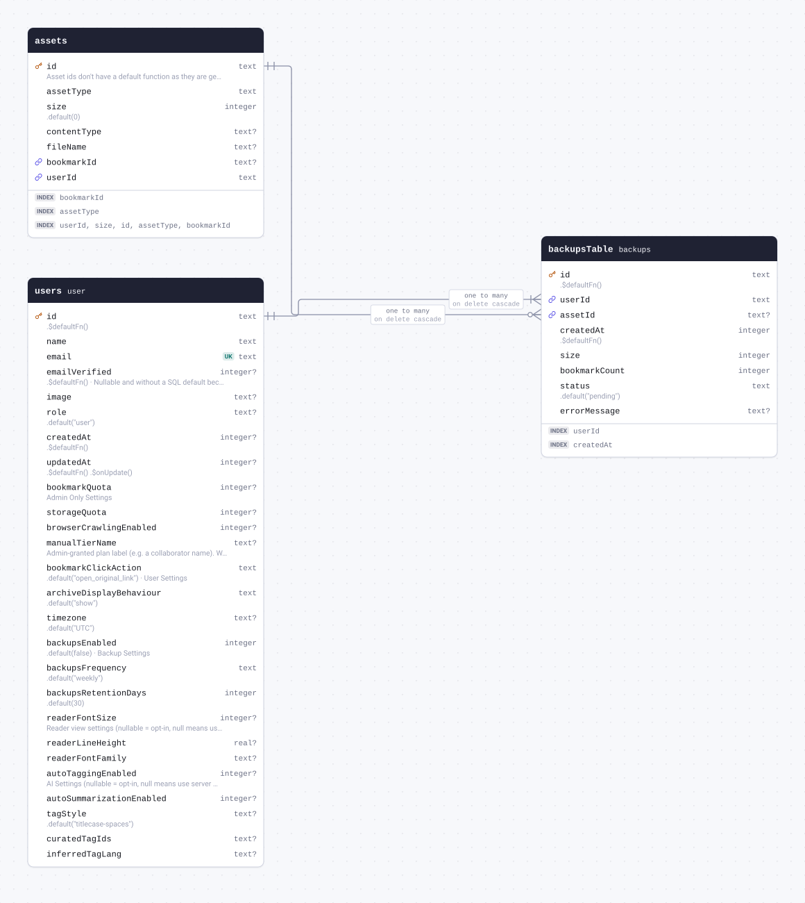

| Column          | Type             | Constraints                         | Default               | Description |
| --------------- | ---------------- | ----------------------------------- | --------------------- | ----------- |
| `id`            | `text`           | PK NOT NULL                         | `.$defaultFn()`       |             |
| `userId`        | `text`           | NOT NULL → [users.id](#table-users) |                       |             |
| `assetId`       | `text`           | NULL → [assets.id](#table-assets)   |                       |             |
| `createdAt`     | `createdAtField` | NULL                                |                       |             |
| `size`          | `integer`        | NOT NULL                            |                       |             |
| `bookmarkCount` | `integer`        | NOT NULL                            |                       |             |
| `status`        | `text`           | NOT NULL                            | `.default("pending")` |             |
| `errorMessage`  | `text`           | NULL                                |                       |             |

#### Indexes

- INDEX `userId`
- INDEX `createdAt`

#### References

- `userId` → [users.id](#table-users) (many to one, on delete cascade)
- `assetId` → [assets.id](#table-assets) (many to one, on delete cascade)

<details>
<summary>Queries</summary>

**Select**: Every row of backupsTable.

```ts
db.select().from(backupsTable);
```

**Count**: How many rows backupsTable has.

```ts
db.$count(backupsTable);
```

**Find many**: The rows of backupsTable, through the relational query API.

```ts
db.query.backupsTable.findMany();
```

</details>

<a id="table-config"></a>

### config

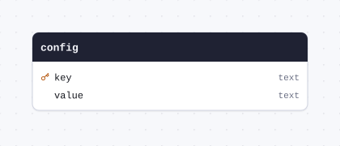

| Column  | Type   | Constraints | Default | Description |
| ------- | ------ | ----------- | ------- | ----------- |
| `key`   | `text` | PK NOT NULL |         |             |
| `value` | `text` | NOT NULL    |         |             |

<details>
<summary>Queries</summary>

**Select**: Every row of config.

```ts
db.select().from(config);
```

**Count**: How many rows config has.

```ts
db.$count(config);
```

**Find many**: The rows of config, through the relational query API.

```ts
db.query.config.findMany();
```

</details>

<a id="table-ruleEngineRulesTable"></a>

### ruleEngineRulesTable

Table `ruleEngineRules`.

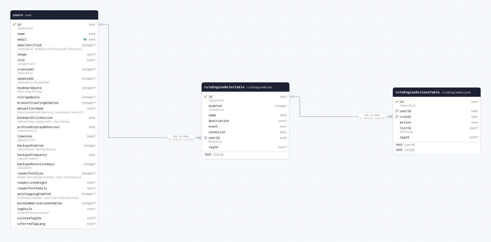

| Column        | Type      | Constraints                         | Default          | Description |
| ------------- | --------- | ----------------------------------- | ---------------- | ----------- |
| `id`          | `text`    | PK NOT NULL                         | `.$defaultFn()`  |             |
| `enabled`     | `integer` | NOT NULL                            | `.default(true)` |             |
| `name`        | `text`    | NOT NULL                            |                  |             |
| `description` | `text`    | NULL                                |                  |             |
| `event`       | `text`    | NOT NULL                            |                  |             |
| `condition`   | `text`    | NOT NULL                            |                  |             |
| `userId`      | `text`    | NOT NULL → [users.id](#table-users) |                  | References  |
| `tagId`       | `text`    | NULL                                |                  |             |

#### Indexes

- INDEX `userId`

#### References

- `userId` → [users.id](#table-users) (many to one, on delete cascade)

#### Referenced by

- `id` → [ruleEngineActionsTable.ruleId](#table-ruleEngineActionsTable) (one to many, on delete cascade)

<details>
<summary>Queries</summary>

**Select**: Every row of ruleEngineRulesTable.

```ts
db.select().from(ruleEngineRulesTable);
```

**Count**: How many rows ruleEngineRulesTable has.

```ts
db.$count(ruleEngineRulesTable);
```

**Find many**: The rows of ruleEngineRulesTable, through the relational query API.

```ts
db.query.ruleEngineRulesTable.findMany();
```

</details>

<a id="table-ruleEngineActionsTable"></a>

### ruleEngineActionsTable

Table `ruleEngineActions`.

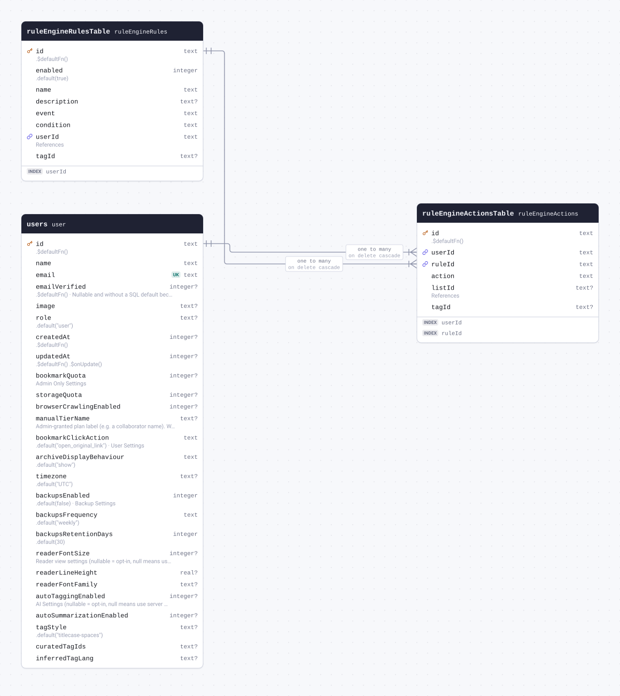

| Column   | Type   | Constraints                                                       | Default         | Description |
| -------- | ------ | ----------------------------------------------------------------- | --------------- | ----------- |
| `id`     | `text` | PK NOT NULL                                                       | `.$defaultFn()` |             |
| `userId` | `text` | NOT NULL → [users.id](#table-users)                               |                 |             |
| `ruleId` | `text` | NOT NULL → [ruleEngineRulesTable.id](#table-ruleEngineRulesTable) |                 |             |
| `action` | `text` | NOT NULL                                                          |                 |             |
| `listId` | `text` | NULL                                                              |                 | References  |
| `tagId`  | `text` | NULL                                                              |                 |             |

#### Indexes

- INDEX `userId`
- INDEX `ruleId`

#### References

- `userId` → [users.id](#table-users) (many to one, on delete cascade)
- `ruleId` → [ruleEngineRulesTable.id](#table-ruleEngineRulesTable) (many to one, on delete cascade)

<details>
<summary>Queries</summary>

**Select**: Every row of ruleEngineActionsTable.

```ts
db.select().from(ruleEngineActionsTable);
```

**Count**: How many rows ruleEngineActionsTable has.

```ts
db.$count(ruleEngineActionsTable);
```

**Find many**: The rows of ruleEngineActionsTable, through the relational query API.

```ts
db.query.ruleEngineActionsTable.findMany();
```

</details>

<a id="table-invites"></a>

### invites

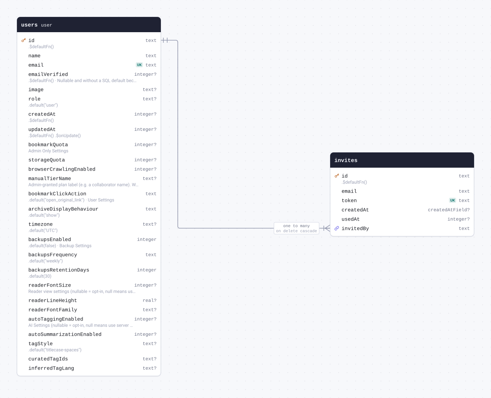

| Column      | Type             | Constraints                         | Default         | Description |
| ----------- | ---------------- | ----------------------------------- | --------------- | ----------- |
| `id`        | `text`           | PK NOT NULL                         | `.$defaultFn()` |             |
| `email`     | `text`           | NOT NULL                            |                 |             |
| `token`     | `text`           | UNIQUE NOT NULL                     |                 |             |
| `createdAt` | `createdAtField` | NULL                                |                 |             |
| `usedAt`    | `integer`        | NULL                                |                 |             |
| `invitedBy` | `text`           | NOT NULL → [users.id](#table-users) |                 |             |

#### References

- `invitedBy` → [users.id](#table-users) (many to one, on delete cascade)

<details>
<summary>Queries</summary>

**Select**: Every row of invites.

```ts
db.select().from(invites);
```

**Count**: How many rows invites has.

```ts
db.$count(invites);
```

**Find many**: The rows of invites, through the relational query API.

```ts
db.query.invites.findMany();
```

</details>

<a id="table-subscriptions"></a>

### subscriptions

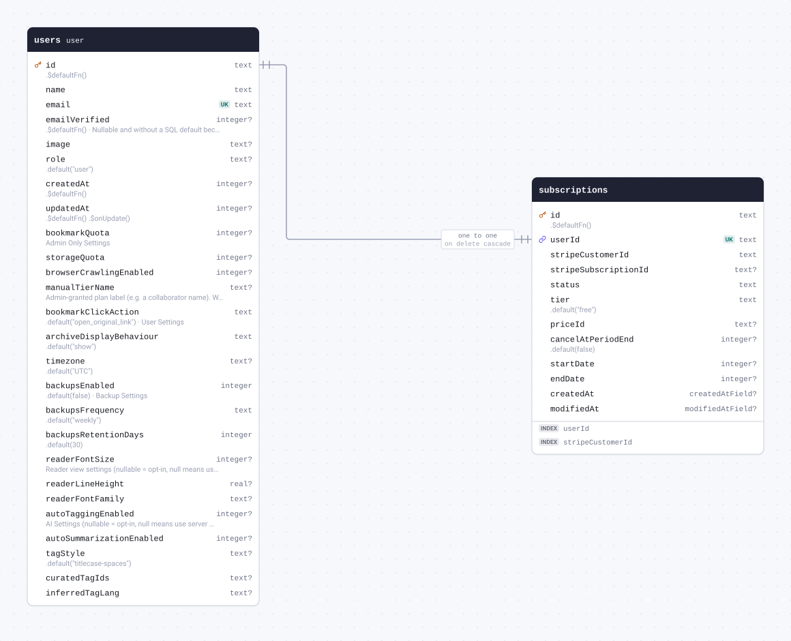

| Column                 | Type              | Constraints                                | Default            | Description |
| ---------------------- | ----------------- | ------------------------------------------ | ------------------ | ----------- |
| `id`                   | `text`            | PK NOT NULL                                | `.$defaultFn()`    |             |
| `userId`               | `text`            | UNIQUE NOT NULL → [users.id](#table-users) |                    |             |
| `stripeCustomerId`     | `text`            | NOT NULL                                   |                    |             |
| `stripeSubscriptionId` | `text`            | NULL                                       |                    |             |
| `status`               | `text`            | NOT NULL                                   |                    |             |
| `tier`                 | `text`            | NOT NULL                                   | `.default("free")` |             |
| `priceId`              | `text`            | NULL                                       |                    |             |
| `cancelAtPeriodEnd`    | `integer`         | NULL                                       | `.default(false)`  |             |
| `startDate`            | `integer`         | NULL                                       |                    |             |
| `endDate`              | `integer`         | NULL                                       |                    |             |
| `createdAt`            | `createdAtField`  | NULL                                       |                    |             |
| `modifiedAt`           | `modifiedAtField` | NULL                                       |                    |             |

#### Indexes

- INDEX `userId`
- INDEX `stripeCustomerId`

#### References

- `userId` → [users.id](#table-users) (one to one, on delete cascade)

<details>
<summary>Queries</summary>

**Select**: Every row of subscriptions.

```ts
db.select().from(subscriptions);
```

**Count**: How many rows subscriptions has.

```ts
db.$count(subscriptions);
```

**Find many**: The rows of subscriptions, through the relational query API.

```ts
db.query.subscriptions.findMany();
```

</details>

<a id="table-inAppSubscriptions"></a>

### inAppSubscriptions

Subscriptions purchased through the mobile app stores (App Store / Google Play). These are managed by RevenueCat, which is the source of truth; this table mirrors the state of the configured RevenueCat entitlement.

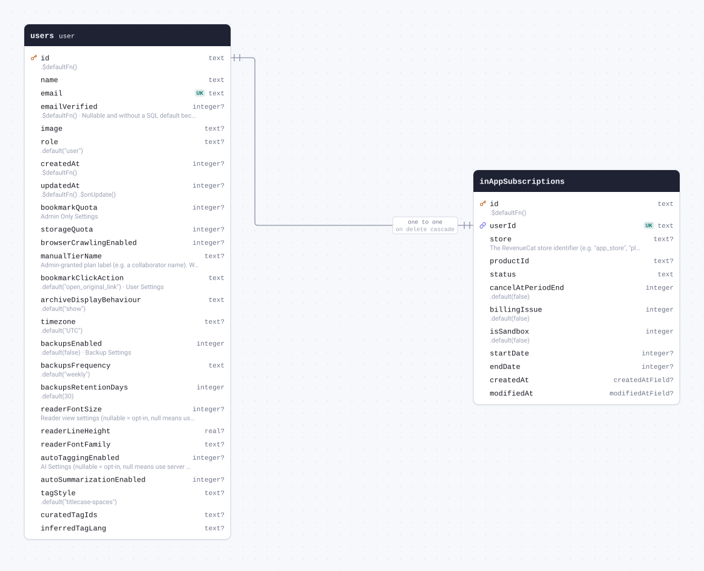

| Column              | Type              | Constraints                                | Default           | Description                                                       |
| ------------------- | ----------------- | ------------------------------------------ | ----------------- | ----------------------------------------------------------------- |
| `id`                | `text`            | PK NOT NULL                                | `.$defaultFn()`   |                                                                   |
| `userId`            | `text`            | UNIQUE NOT NULL → [users.id](#table-users) |                   |                                                                   |
| `store`             | `text`            | NULL                                       |                   | The RevenueCat store identifier (e.g. "app_store", "play_store"). |
| `productId`         | `text`            | NULL                                       |                   |                                                                   |
| `status`            | `text`            | NOT NULL                                   |                   |                                                                   |
| `cancelAtPeriodEnd` | `integer`         | NOT NULL                                   | `.default(false)` |                                                                   |
| `billingIssue`      | `integer`         | NOT NULL                                   | `.default(false)` |                                                                   |
| `isSandbox`         | `integer`         | NOT NULL                                   | `.default(false)` |                                                                   |
| `startDate`         | `integer`         | NULL                                       |                   |                                                                   |
| `endDate`           | `integer`         | NULL                                       |                   |                                                                   |
| `createdAt`         | `createdAtField`  | NULL                                       |                   |                                                                   |
| `modifiedAt`        | `modifiedAtField` | NULL                                       |                   |                                                                   |

#### References

- `userId` → [users.id](#table-users) (one to one, on delete cascade)

<details>
<summary>Queries</summary>

**Select**: Every row of inAppSubscriptions.

```ts
db.select().from(inAppSubscriptions);
```

**Count**: How many rows inAppSubscriptions has.

```ts
db.$count(inAppSubscriptions);
```

**Find many**: The rows of inAppSubscriptions, through the relational query API.

```ts
db.query.inAppSubscriptions.findMany();
```

</details>

<a id="table-importSessions"></a>

### importSessions

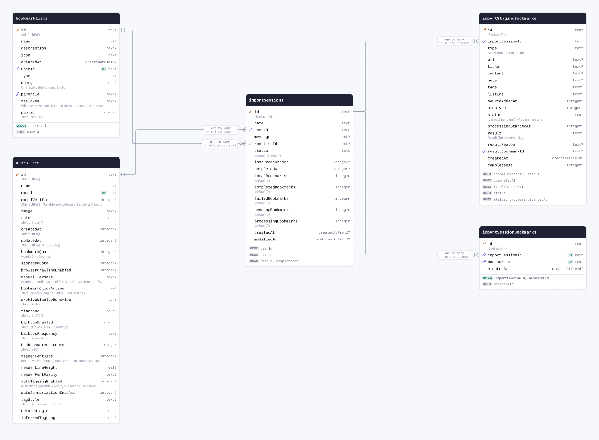

| Column                | Type              | Constraints                                     | Default               | Description |
| --------------------- | ----------------- | ----------------------------------------------- | --------------------- | ----------- |
| `id`                  | `text`            | PK NOT NULL                                     | `.$defaultFn()`       |             |
| `name`                | `text`            | NOT NULL                                        |                       |             |
| `userId`              | `text`            | NOT NULL → [users.id](#table-users)             |                       |             |
| `message`             | `text`            | NULL                                            |                       |             |
| `rootListId`          | `text`            | NULL → [bookmarkLists.id](#table-bookmarkLists) |                       |             |
| `status`              | `text`            | NOT NULL                                        | `.default("staging")` |             |
| `lastProcessedAt`     | `integer`         | NULL                                            |                       |             |
| `completedAt`         | `integer`         | NULL                                            |                       |             |
| `totalBookmarks`      | `integer`         | NOT NULL                                        | `.default(0)`         |             |
| `completedBookmarks`  | `integer`         | NOT NULL                                        | `.default(0)`         |             |
| `failedBookmarks`     | `integer`         | NOT NULL                                        | `.default(0)`         |             |
| `pendingBookmarks`    | `integer`         | NOT NULL                                        | `.default(0)`         |             |
| `processingBookmarks` | `integer`         | NOT NULL                                        | `.default(0)`         |             |
| `createdAt`           | `createdAtField`  | NULL                                            |                       |             |
| `modifiedAt`          | `modifiedAtField` | NULL                                            |                       |             |

#### Indexes

- INDEX `userId`
- INDEX `status`
- INDEX `status`, `completedAt`

#### References

- `userId` → [users.id](#table-users) (many to one, on delete cascade)
- `rootListId` → [bookmarkLists.id](#table-bookmarkLists) (many to one, on delete set null)

#### Referenced by

- `id` → [importSessionBookmarks.importSessionId](#table-importSessionBookmarks) (one to many, on delete cascade)
- `id` → [importStagingBookmarks.importSessionId](#table-importStagingBookmarks) (one to many, on delete cascade)

<details>
<summary>Queries</summary>

**Select**: Every row of importSessions.

```ts
db.select().from(importSessions);
```

**Count**: How many rows importSessions has.

```ts
db.$count(importSessions);
```

**Find many**: The rows of importSessions, through the relational query API.

```ts
db.query.importSessions.findMany();
```

</details>

<a id="table-importSessionBookmarks"></a>

### importSessionBookmarks

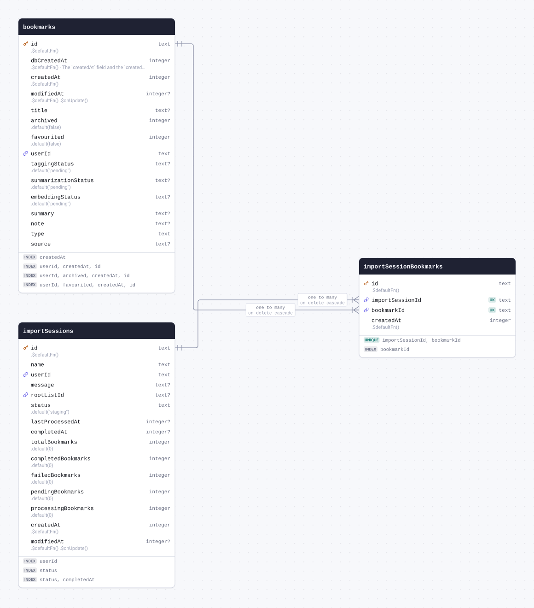

| Column            | Type             | Constraints                                           | Default         | Description |
| ----------------- | ---------------- | ----------------------------------------------------- | --------------- | ----------- |
| `id`              | `text`           | PK NOT NULL                                           | `.$defaultFn()` |             |
| `importSessionId` | `text`           | NOT NULL → [importSessions.id](#table-importSessions) |                 |             |
| `bookmarkId`      | `text`           | NOT NULL → [bookmarks.id](#table-bookmarks)           |                 |             |
| `createdAt`       | `createdAtField` | NULL                                                  |                 |             |

#### Indexes

- INDEX `bookmarkId`
- UNIQUE `importSessionId`, `bookmarkId`

#### References

- `importSessionId` → [importSessions.id](#table-importSessions) (many to one, on delete cascade)
- `bookmarkId` → [bookmarks.id](#table-bookmarks) (many to one, on delete cascade)

<details>
<summary>Queries</summary>

**Select**: Every row of importSessionBookmarks.

```ts
db.select().from(importSessionBookmarks);
```

**Count**: How many rows importSessionBookmarks has.

```ts
db.$count(importSessionBookmarks);
```

**Find many**: The rows of importSessionBookmarks, through the relational query API.

```ts
db.query.importSessionBookmarks.findMany();
```

</details>

<a id="table-importStagingBookmarks"></a>

### importStagingBookmarks

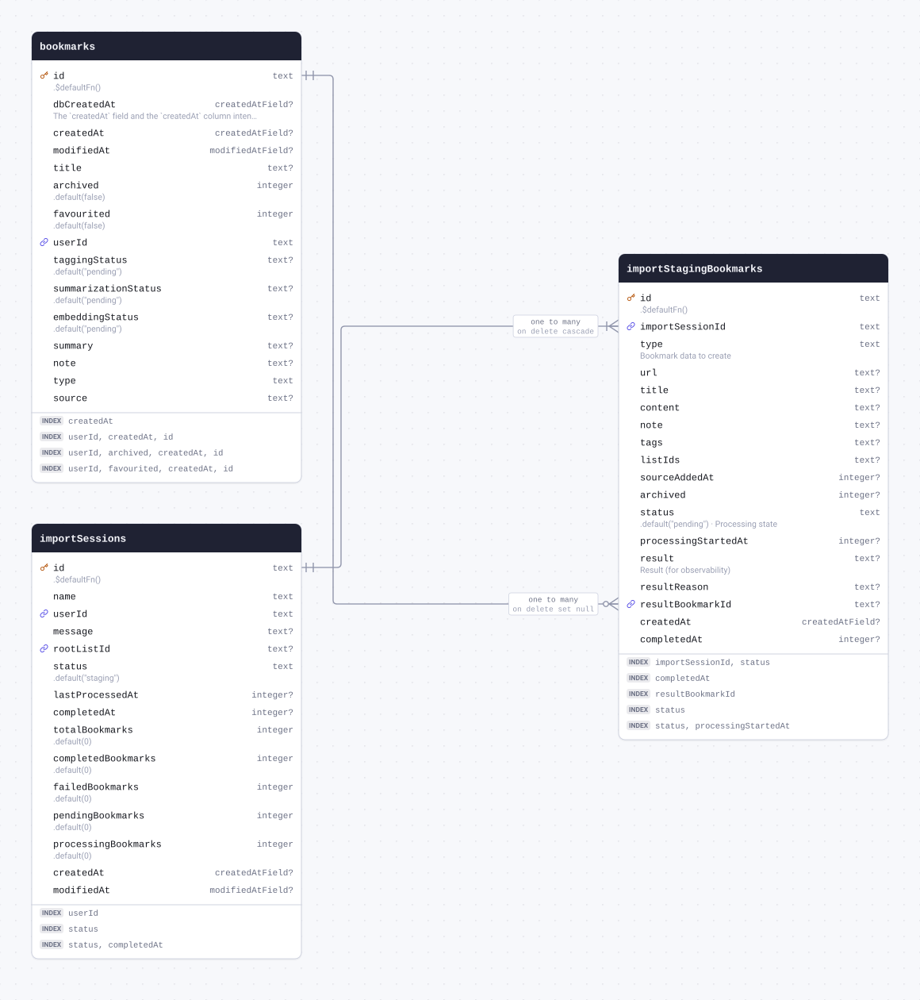

| Column                | Type             | Constraints                                           | Default               | Description                |
| --------------------- | ---------------- | ----------------------------------------------------- | --------------------- | -------------------------- |
| `id`                  | `text`           | PK NOT NULL                                           | `.$defaultFn()`       |                            |
| `importSessionId`     | `text`           | NOT NULL → [importSessions.id](#table-importSessions) |                       |                            |
| `type`                | `text`           | NOT NULL                                              |                       | Bookmark data to create    |
| `url`                 | `text`           | NULL                                                  |                       |                            |
| `title`               | `text`           | NULL                                                  |                       |                            |
| `content`             | `text`           | NULL                                                  |                       |                            |
| `note`                | `text`           | NULL                                                  |                       |                            |
| `tags`                | `text`           | NULL                                                  |                       |                            |
| `listIds`             | `text`           | NULL                                                  |                       |                            |
| `sourceAddedAt`       | `integer`        | NULL                                                  |                       |                            |
| `archived`            | `integer`        | NULL                                                  |                       |                            |
| `status`              | `text`           | NOT NULL                                              | `.default("pending")` | Processing state           |
| `processingStartedAt` | `integer`        | NULL                                                  |                       |                            |
| `result`              | `text`           | NULL                                                  |                       | Result (for observability) |
| `resultReason`        | `text`           | NULL                                                  |                       |                            |
| `resultBookmarkId`    | `text`           | NULL → [bookmarks.id](#table-bookmarks)               |                       |                            |
| `createdAt`           | `createdAtField` | NULL                                                  |                       |                            |
| `completedAt`         | `integer`        | NULL                                                  |                       |                            |

#### Indexes

- INDEX `importSessionId`, `status`
- INDEX `completedAt`
- INDEX `resultBookmarkId`
- INDEX `status`
- INDEX `status`, `processingStartedAt`

#### References

- `importSessionId` → [importSessions.id](#table-importSessions) (many to one, on delete cascade)
- `resultBookmarkId` → [bookmarks.id](#table-bookmarks) (many to one, on delete set null)

<details>
<summary>Queries</summary>

**Select**: Every row of importStagingBookmarks.

```ts
db.select().from(importStagingBookmarks);
```

**Count**: How many rows importStagingBookmarks has.

```ts
db.$count(importStagingBookmarks);
```

**Find many**: The rows of importStagingBookmarks, through the relational query API.

```ts
db.query.importStagingBookmarks.findMany();
```

</details>
