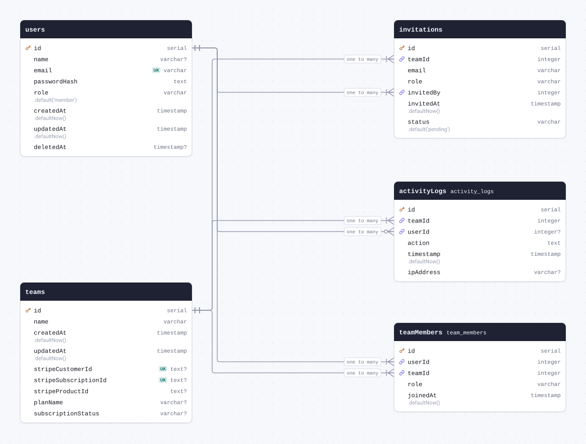
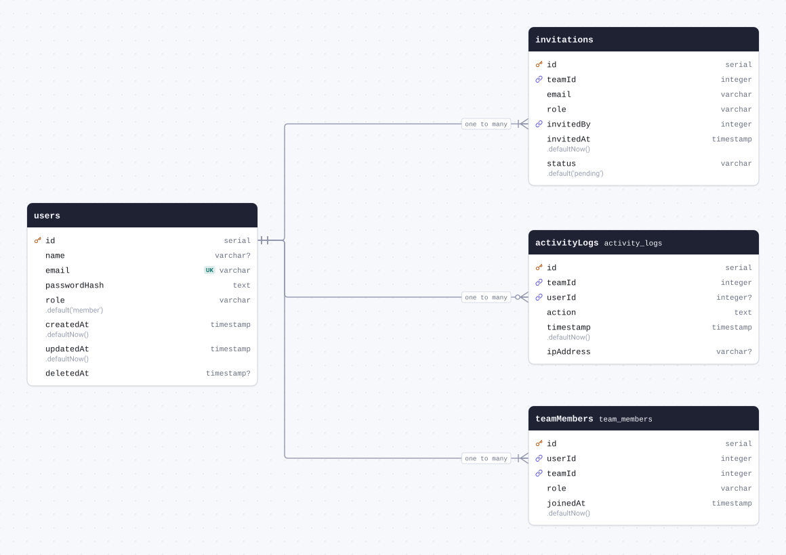
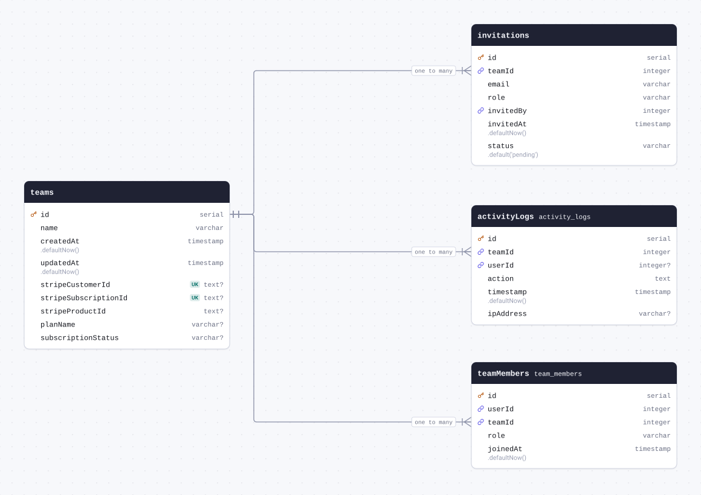
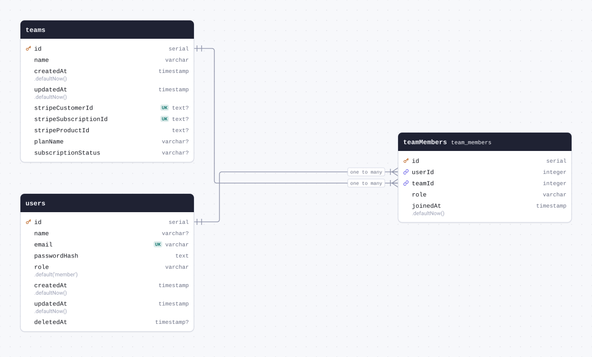
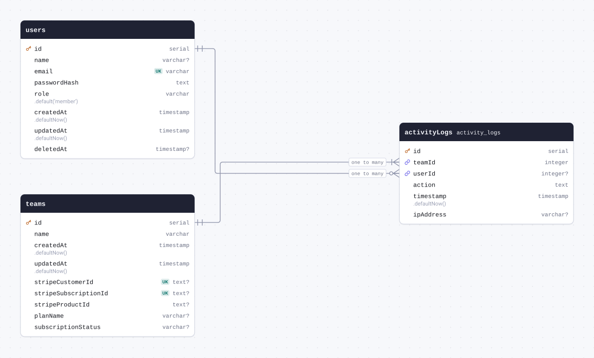
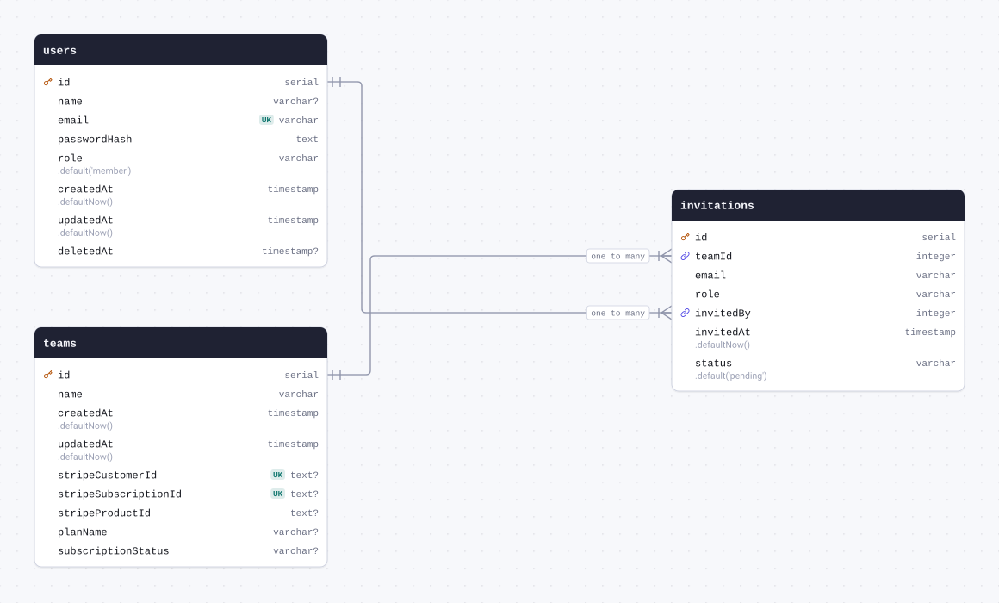

# Schema docs



## Contents

| Table                               | Name in the database | Description |
| ----------------------------------- | -------------------- | ----------- |
| [users](#table-users)               | `users`              |             |
| [teams](#table-teams)               | `teams`              |             |
| [teamMembers](#table-teamMembers)   | `team_members`       |             |
| [activityLogs](#table-activityLogs) | `activity_logs`      |             |
| [invitations](#table-invitations)   | `invitations`        |             |

## Tables

<a id="table-users"></a>

### users



| Column                           | Type        | Constraints     | Default              | Description |
| -------------------------------- | ----------- | --------------- | -------------------- | ----------- |
| `id`                             | `serial`    | PK NOT NULL     |                      |             |
| `name`                           | `varchar`   | NULL            |                      |             |
| `email`                          | `varchar`   | UNIQUE NOT NULL |                      |             |
| `passwordHash` (`password_hash`) | `text`      | NOT NULL        |                      |             |
| `role`                           | `varchar`   | NOT NULL        | `.default('member')` |             |
| `createdAt` (`created_at`)       | `timestamp` | NOT NULL        | `.defaultNow()`      |             |
| `updatedAt` (`updated_at`)       | `timestamp` | NOT NULL        | `.defaultNow()`      |             |
| `deletedAt` (`deleted_at`)       | `timestamp` | NULL            |                      |             |

#### Referenced by

- `id` → [teamMembers.userId](#table-teamMembers) (one to many)
- `id` → [activityLogs.userId](#table-activityLogs) (one to many)
- `id` → [invitations.invitedBy](#table-invitations) (one to many)

<details>
<summary>Queries</summary>

**Select**: Every row of users.

```ts
db.select().from(users);
```

**Count**: How many rows users has.

```ts
db.$count(users);
```

**Find many**: The rows of users, through the relational query API.

```ts
db.query.users.findMany();
```

</details>

<a id="table-teams"></a>

### teams



| Column                                            | Type        | Constraints | Default         | Description |
| ------------------------------------------------- | ----------- | ----------- | --------------- | ----------- |
| `id`                                              | `serial`    | PK NOT NULL |                 |             |
| `name`                                            | `varchar`   | NOT NULL    |                 |             |
| `createdAt` (`created_at`)                        | `timestamp` | NOT NULL    | `.defaultNow()` |             |
| `updatedAt` (`updated_at`)                        | `timestamp` | NOT NULL    | `.defaultNow()` |             |
| `stripeCustomerId` (`stripe_customer_id`)         | `text`      | UNIQUE NULL |                 |             |
| `stripeSubscriptionId` (`stripe_subscription_id`) | `text`      | UNIQUE NULL |                 |             |
| `stripeProductId` (`stripe_product_id`)           | `text`      | NULL        |                 |             |
| `planName` (`plan_name`)                          | `varchar`   | NULL        |                 |             |
| `subscriptionStatus` (`subscription_status`)      | `varchar`   | NULL        |                 |             |

#### Referenced by

- `id` → [teamMembers.teamId](#table-teamMembers) (one to many)
- `id` → [activityLogs.teamId](#table-activityLogs) (one to many)
- `id` → [invitations.teamId](#table-invitations) (one to many)

<details>
<summary>Queries</summary>

**Select**: Every row of teams.

```ts
db.select().from(teams);
```

**Count**: How many rows teams has.

```ts
db.$count(teams);
```

**Find many**: The rows of teams, through the relational query API.

```ts
db.query.teams.findMany();
```

</details>

<a id="table-teamMembers"></a>

### teamMembers

Table `team_members`.



| Column                   | Type        | Constraints                         | Default         | Description |
| ------------------------ | ----------- | ----------------------------------- | --------------- | ----------- |
| `id`                     | `serial`    | PK NOT NULL                         |                 |             |
| `userId` (`user_id`)     | `integer`   | NOT NULL → [users.id](#table-users) |                 |             |
| `teamId` (`team_id`)     | `integer`   | NOT NULL → [teams.id](#table-teams) |                 |             |
| `role`                   | `varchar`   | NOT NULL                            |                 |             |
| `joinedAt` (`joined_at`) | `timestamp` | NOT NULL                            | `.defaultNow()` |             |

#### References

- `userId` → [users.id](#table-users) (many to one)
- `teamId` → [teams.id](#table-teams) (many to one)

<details>
<summary>Queries</summary>

**Select**: Every row of teamMembers.

```ts
db.select().from(teamMembers);
```

**Count**: How many rows teamMembers has.

```ts
db.$count(teamMembers);
```

**Find many**: The rows of teamMembers, through the relational query API.

```ts
db.query.teamMembers.findMany();
```

</details>

<a id="table-activityLogs"></a>

### activityLogs

Table `activity_logs`.



| Column                     | Type        | Constraints                         | Default         | Description |
| -------------------------- | ----------- | ----------------------------------- | --------------- | ----------- |
| `id`                       | `serial`    | PK NOT NULL                         |                 |             |
| `teamId` (`team_id`)       | `integer`   | NOT NULL → [teams.id](#table-teams) |                 |             |
| `userId` (`user_id`)       | `integer`   | NULL → [users.id](#table-users)     |                 |             |
| `action`                   | `text`      | NOT NULL                            |                 |             |
| `timestamp`                | `timestamp` | NOT NULL                            | `.defaultNow()` |             |
| `ipAddress` (`ip_address`) | `varchar`   | NULL                                |                 |             |

#### References

- `teamId` → [teams.id](#table-teams) (many to one)
- `userId` → [users.id](#table-users) (many to one)

<details>
<summary>Queries</summary>

**Select**: Every row of activityLogs.

```ts
db.select().from(activityLogs);
```

**Count**: How many rows activityLogs has.

```ts
db.$count(activityLogs);
```

**Find many**: The rows of activityLogs, through the relational query API.

```ts
db.query.activityLogs.findMany();
```

</details>

<a id="table-invitations"></a>

### invitations



| Column                     | Type        | Constraints                         | Default               | Description |
| -------------------------- | ----------- | ----------------------------------- | --------------------- | ----------- |
| `id`                       | `serial`    | PK NOT NULL                         |                       |             |
| `teamId` (`team_id`)       | `integer`   | NOT NULL → [teams.id](#table-teams) |                       |             |
| `email`                    | `varchar`   | NOT NULL                            |                       |             |
| `role`                     | `varchar`   | NOT NULL                            |                       |             |
| `invitedBy` (`invited_by`) | `integer`   | NOT NULL → [users.id](#table-users) |                       |             |
| `invitedAt` (`invited_at`) | `timestamp` | NOT NULL                            | `.defaultNow()`       |             |
| `status`                   | `varchar`   | NOT NULL                            | `.default('pending')` |             |

#### References

- `teamId` → [teams.id](#table-teams) (many to one)
- `invitedBy` → [users.id](#table-users) (many to one)

<details>
<summary>Queries</summary>

**Select**: Every row of invitations.

```ts
db.select().from(invitations);
```

**Count**: How many rows invitations has.

```ts
db.$count(invitations);
```

**Find many**: The rows of invitations, through the relational query API.

```ts
db.query.invitations.findMany();
```

</details>
